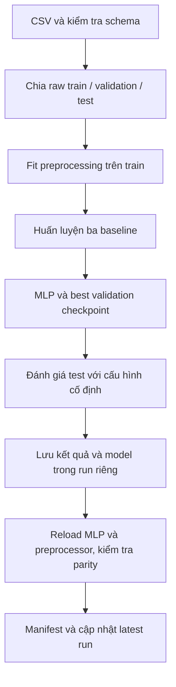

# 🏠 Bài Lab Dự Đoán Giá Nhà California (Predicting House Prices)

Bài lab thực hành **hồi quy có giám sát** để dự đoán giá trị nhà trung vị của một khu dân cư. Quy trình gồm kiểm tra dữ liệu, chia tập độc lập, tiền xử lý, huấn luyện ba baseline và mạng MLP, đánh giá sai số, lưu/nạp mô hình và thử suy luận.

> **Cách triển khai:** MLP bằng PyTorch; Linear Regression, Decision Tree và Random Forest bằng scikit-learn. Dữ liệu bảng được xử lý bằng pandas/NumPy. Đây không phải dự án tự cài đặt mọi thuật toán từ đầu.
>
> **Kiểm chứng ngày 16/11/2026:** **53/53 tests pass**, gồm unit tests, integration tests và regression tests. Ba notebook đã chạy tuần tự và lưu output. Số liệu tham chiếu bên dưới thuộc luồng **`main.py`**, không lấy kết quả notebook thay cho CLI.
>
> **Nguồn kết quả:** mỗi CLI run có thư mục `runs/<run_id>/` riêng. [`results/latest_run.json`](results/latest_run.json) trỏ tới lần chạy hoàn tất mới nhất. Chỉ đối chiếu artifacts thuộc cùng run.

---

## 1. Mô Tả Bài Toán & Dữ Liệu (Problem & Data)

### 1.1. Mục tiêu hồi quy

Đầu vào là đặc trưng vị trí, dân số, thu nhập và quy mô nhà ở của một khu dân cư. Đầu ra là `median_house_value`, đơn vị **USD**. Đây là giá trị trung vị của khu vực trong dữ liệu khảo sát, không phải giá giao dịch hiện tại của từng căn nhà.

### 1.2. Dữ liệu và schema

File cục bộ [`data/raw/housing.csv`](data/raw/housing.csv) gồm **20.640 dòng**, 9 features và một target.

| Nhóm | Các cột | Xử lý |
| --- | --- | --- |
| Địa lý | `longitude`, `latitude` | Median imputation, standardization |
| Quy mô và kinh tế | `housing_median_age`, `total_rooms`, `total_bedrooms`, `population`, `households`, `median_income` | Median imputation, optional feature engineering, standardization |
| Phân loại | `ocean_proximity` | Most-frequent imputation, one-hot encoding |
| Target | `median_house_value` | Giữ USD; MLP chuẩn hóa nội bộ từ train |

[`load_housing_data()`](src/data/loader.py) kiểm tra schema, kiểu số, target hữu hạn và dữ liệu phân loại dạng chuỗi. Loader không tự tải dữ liệu hoặc điền target thiếu. Missing features được xử lý ở preprocessor; cột hoàn toàn thiếu trên train bị từ chối khi fit.

### 1.3. Kiểm tra chất lượng dữ liệu

| Hạng mục | Kết quả trên CSV hiện tại |
| --- | ---: |
| Tổng số dòng | 20.640 |
| Dòng trùng hoàn toàn | 0 |
| Thiếu `total_bedrooms` | 207 |
| Target bằng 500.001 USD | 965 |
| Nhóm `ISLAND` | 5 |

Thống kê tổng quan toàn bộ CSV phục vụ mô tả dữ liệu. EDA chi tiết và các thống kê dùng để biến đổi features chỉ sử dụng train. Không loại mẫu chỉ vì giá cao, ngoại lai hoặc mô hình dự đoán sai.

### 1.4. Train / Validation / Test

| Tập | Tỷ lệ | Số mẫu | Vai trò |
| --- | ---: | ---: | --- |
| Train | 80% | 16.512 | Fit preprocessing, target scaling và mô hình |
| Validation | 10% | 2.064 | Theo dõi training, chọn checkpoint MLP, đối chiếu cấu hình |
| Test | 10% | 2.064 | Đánh giá cuối với mô hình đã cố định |

Mặc định seed **42**. `split_data_8_1_1()` dùng `pd.qcut` trên **target giá nhà**: 10 bins khi tách train/temp, rồi 5 bins khi chia temp thành validation/test. Số bins thực tế có thể giảm nếu ranh giới phân vị trùng nhau. Không phân tầng theo thu nhập hoặc `income_cat`.

---

## 2. Nguyên Tắc Thiết Kế & Kiểm Soát Thực Nghiệm

### 2.1. Chia tập trước, fit trên train

Imputer, scaler và danh sách nhãn one-hot chỉ học trên train. Validation, test và inference dùng `transform()` của chính bộ biến đổi đó. Baseline và MLP dùng chung splits và ma trận features trong mỗi run.

### 2.2. Baseline trước mạng nơ-ron

Linear Regression tạo mốc tuyến tính; Decision Tree và Random Forest bổ sung đối chứng phi tuyến. MLP được huấn luyện sau baseline. Dự án không giả định mạng nơ-ron phải tốt hơn mô hình cây.

### 2.3. Metrics và chọn checkpoint

RMSE dùng để so sánh sai số theo USD; MAE bổ sung mức sai lệch trung bình, MSE và R² cung cấp góc nhìn khác. MLP chọn checkpoint có **validation MSE thấp nhất**, tương đương validation RMSE thấp nhất. Chạy đủ epochs rồi khôi phục checkpoint; không early stopping và không chọn epoch theo test.

### 2.4. Kiểm tra tính nhất quán artifacts

Mỗi CLI run có thư mục riêng. Khi hoàn tất, `manifest.json` ghi cấu hình thực tế, hash dữ liệu, hash mã nguồn, phiên bản thư viện, số chiều features và hash artifacts. Con trỏ `results/latest_run.json` chỉ được thay thế sau khi run đã xác minh.

Nếu training thất bại, con trỏ không đổi và run trước vẫn nguyên vẹn. `load_cli_run()` kiểm tra hash trước khi nạp bộ preprocessor/model. Hash kiểm tra tính nhất quán, không phải chữ ký xác thực nguồn; chỉ nạp artifacts cục bộ đáng tin cậy.

---

## 3. Tiền Xử Lý & Biểu Diễn Đặc Trưng (Preprocessing & Features)

### 3.1. Pipeline biến đổi

[`fit_preprocessor()`](src/data/preprocessing.py) tạo `ColumnTransformer`:

1. Nhánh số: median imputation → `HousingFeatureEngineer` → `StandardScaler`.
2. Nhánh phân loại: most-frequent imputation → `OneHotEncoder(handle_unknown='ignore', sparse_output=False)`.
3. Ghép thành dense numeric array; kiểm tra số chiều và giá trị hữu hạn.

Với cấu hình mặc định và train hiện tại: **8 numeric + 5 one-hot = 13 features**. Nhãn phân loại mới được biểu diễn bằng vector one-hot toàn 0. Số chiều phụ thuộc nhãn thực sự có trên train, không hardcode trong model hoặc notebook.

### 3.2. Feature engineering tùy chọn

| Feature | Công thức |
| --- | --- |
| `rooms_per_household` | `total_rooms / households` |
| `bedrooms_ratio` | `total_bedrooms / total_rooms` |
| `people_per_household` | `population / households` |

Ratios được tính **sau imputation, trước log1p**; mẫu số không dương bị từ chối. `--apply-log` áp dụng `log1p` lên `total_rooms`, `total_bedrooms`, `population`, `households`. `--create-interactions` bật ba ratios, tăng số chiều hiện tại từ 13 lên **16**.

Cấu hình tham chiếu chưa bật hai tùy chọn. Notebook 02 đối chiếu Linear Regression với ratios + log trên validation, không tự thay mô hình chuẩn theo test.

### 3.3. Target scaling của MLP

$$
z_i = \frac{y_i-\mu_{train}}{\sigma_{train}},\qquad
\hat y_i = \hat z_i\sigma_{train}+\mu_{train}
$$

Mean và population standard deviation chỉ tính trên `y_train`; target hằng số dùng scale = 1. Phép biến đổi đưa target về mean 0 và standard deviation 1 khi phương sai khác 0, **không biến phân phối bất kỳ thành phân phối chuẩn**. Thống kê được lưu trong checkpoint cùng weights; implementation không có lớp riêng tên `TargetScaler`.

---

## 4. Phương Pháp Hồi Quy & Toán Học Cốt Lõi

| Mô hình | Cấu hình tham chiếu | Vai trò và giới hạn |
| --- | --- | --- |
| Linear Regression | OLS, `fit_intercept=True` | Mốc tuyến tính, hạn chế với tương tác phi tuyến |
| Decision Tree | `max_depth=5`, seed 42 | Phân vùng theo nhánh; độ sâu giới hạn có thể gây underfitting |
| Random Forest | 100 cây, bootstrap, `max_features=1.0`, seed 42 | Trung bình hóa nhiều cây; tốn bộ nhớ hơn cây đơn |
| MLP PyTorch | 32 ReLU → 16 ReLU → 1 linear | Học tổ hợp phi tuyến; nhạy với scaling và tối ưu |

Linear Regression dự đoán $\hat y=w^\top x+b$ và tối thiểu hóa sai số bình phương. Cây dự đoán theo trung bình tại lá; Random Forest lấy trung bình dự đoán của các cây. Với `max_features=1.0`, mỗi nút xét toàn bộ features, không thực hiện feature subsampling trong cấu hình này.

MLP dùng Adam, learning rate **0,001**, batch size **32**, **100 epochs** trên CPU. Objective là MSE trên target chuẩn hóa; history lưu MSE USD² và MAE USD trên snapshot cuối mỗi epoch. Kiến trúc 32–16–1, ReLU, Adam và MSE là lựa chọn cố định.

$$
MSE=\frac{1}{N}\sum_i(y_i-\hat y_i)^2,\quad RMSE=\sqrt{MSE},\quad
MAE=\frac{1}{N}\sum_i|y_i-\hat y_i|
$$

$$
R^2=1-\frac{\sum_i(y_i-\hat y_i)^2}{\sum_i(y_i-\bar y)^2}
$$

MSE có đơn vị USD²; RMSE và MAE có đơn vị USD; R² không có đơn vị và có thể âm. Target hằng số với ít nhất hai mẫu áp dụng `r2_score(force_finite=True)`; một mẫu không đủ để diễn giải R².

---

## 5. Luồng Xử Lý Toàn Trình (Pipeline)



[`main.py`](main.py) điều phối; logic dữ liệu, features, models và evaluation nằm trong `src/`. CLI demo nạp lại MLP/preprocessor vừa lưu và dự đoán **ba dòng đầu của test**, đối chiếu prediction trước/sau reload. Đây không phải ba mẫu mới thu thập độc lập.

---

## 6. Cấu Trúc Thư Mục Dự Án (Project Structure)

```text
Lab_4 Predicting House Prices/
├── main.py
├── README.md
├── requirements.txt
├── data/raw/housing.csv
├── docs/design.md
├── docs/algorithims/
├── src/
│   ├── config.py                    # Defaults có hiệu lực
│   ├── data/                        # Loader, split, preprocessing
│   ├── features/                    # Ratios và log1p
│   ├── models/                      # Baselines, MLP, persistence
│   ├── evaluation/                  # Metrics và visualization
│   └── utils/                       # Logging
├── tests/                           # Unit, integration, regression
├── notebooks/
│   ├── 01_eda_and_preprocessing.ipynb
│   ├── 02_mlp_model_training.ipynb
│   ├── 03_baseline_and_comparison.ipynb
│   ├── README.md
│   └── artifacts/                   # Cache bàn giao riêng của notebook
├── runs/<run_id>/                   # Mỗi CLI run là một bộ độc lập
│   ├── data/processed/
│   ├── results/figures/
│   ├── results/metrics/
│   ├── results/saved_models/
│   ├── logs/training.log
│   └── manifest.json
└── results/latest_run.json          # Con trỏ run hoàn tất mới nhất
```

`data/processed/` và `results/{metrics,figures,saved_models}/` ở gốc có thể còn kết quả phiên bản cũ. CLI mới không ghi đè hoặc coi chúng là run hiện tại. Đường dẫn chuẩn được giải qua con trỏ hoặc run ID cụ thể.

---

## 7. Ánh Xạ Thiết Kế Với Phần Triển Khai

Đối chiếu theo [`docs/design.md`](docs/design.md); California Housing, split 80/10/10 và PyTorch là các lựa chọn thiết kế của project.

| Nội dung | Module / notebook | Cách xác minh |
| --- | --- | --- |
| Schema và chia tập | `src/data/`, notebook 01 | Bảo toàn dòng, index, seed, train-only statistics |
| Feature engineering | `src/features/`, notebook 02 | Ratios, log và nhánh validation riêng |
| Baseline trước MLP | `src/models/`, `main.py` | Integration test kiểm tra thứ tự |
| Scaling và checkpoint | `mlp_model.py` | USD metrics, seed, lowest validation loss |
| Test cuối cùng | `metrics.py`, notebook 03 | Công thức metrics và thứ tự truy cập test |
| Save/load và inference | `persistence.py` | Prediction parity, hash mismatch, run bị ngắt |
| Notebook độc lập | Ba file `.ipynb` | Output trong notebook, cache dưới `notebooks/artifacts/` |

---

## 8. Kết Quả Thực Nghiệm Tham Chiếu (Evaluation Results)

<!-- VERIFIED_RUN_START -->
### 8.1. Run tham chiếu và nguồn số liệu

Run **`20261116T113320345877Z_6c8931e5`**, ngày **16/11/2026**, seed 42, 13 features, MLP 100 epochs, batch 32, learning rate 0,001. Best validation checkpoint: **epoch 100**.

Đã đối chiếu **25/25 hashes artifacts**, **18/18 hashes mã nguồn/dependency spec** và fingerprint CSV gốc. Xem [manifest của run](runs/20261116T113320345877Z_6c8931e5/manifest.json). Có đủ 15 PNG; không lấy số liệu từ cache notebook.

### 8.2. Validation — 2.064 mẫu

Nguồn: [validation_summary.csv](runs/20261116T113320345877Z_6c8931e5/results/metrics/validation_summary.csv).

| Mô hình | RMSE (USD) | MAE (USD) | MSE (USD²) | R² |
| --- | ---: | ---: | ---: | ---: |
| Random Forest | 50.474,83 | 32.535,17 | 2.547.708.533,51 | 0,8074 |
| MLP PyTorch | 55.288,39 | 36.551,04 | 3.056.805.741,45 | 0,7689 |
| Decision Tree | 71.822,64 | 50.444,72 | 5.158.492.192,23 | 0,6101 |
| Linear Regression | 74.051,58 | 51.760,14 | 5.483.637.211,76 | 0,5855 |

### 8.3. Test — 2.064 mẫu

Nguồn: [model_performance_summary.csv](runs/20261116T113320345877Z_6c8931e5/results/metrics/model_performance_summary.csv).

| Mô hình | RMSE (USD) | MAE (USD) | MSE (USD²) | R² |
| --- | ---: | ---: | ---: | ---: |
| Random Forest | 47.929,97 | 31.298,94 | 2.297.281.701,04 | 0,8255 |
| MLP PyTorch | 51.403,48 | 35.366,58 | 2.642.317.401,20 | 0,7993 |
| Linear Regression | 66.683,76 | 49.481,55 | 4.446.723.192,43 | 0,6622 |
| Decision Tree | 70.063,55 | 49.788,76 | 4.908.901.183,75 | 0,6271 |

Random Forest có RMSE thấp nhất trong bốn cấu hình trên cả validation và test của lần chạy này. Trên test, RMSE Random Forest là **47.929,97 USD**, MLP là **51.403,48 USD**. Đây là mô tả kết quả cố định, không phải bước chọn lại mô hình theo test.

### 8.4. Minh họa inference sau reload

Nguồn: [sample_predictions.csv](runs/20261116T113320345877Z_6c8931e5/results/metrics/sample_predictions.csv). Ba dòng đầu của test, chỉ báo prediction MLP; sai số tuyệt đối luôn không âm.

| Mẫu test | Thực tế (USD) | MLP dự đoán (USD) | Absolute error (USD) |
| --- | ---: | ---: | ---: |
| 1 | 145.600,00 | 213.043,30 | 67.443,30 |
| 2 | 100.000,00 | 105.835,08 | 5.835,08 |
| 3 | 137.600,00 | 129.420,39 | 8.179,61 |

Prediction sau reload khớp trước reload trong tolerance `rtol=1e-5, atol=1e-3`. Không dùng ba mẫu này để suy ra chất lượng toàn bộ model.

### 8.5. Biểu đồ và diễn giải

- [Learning curves](runs/20261116T113320345877Z_6c8931e5/results/figures/loss_curve.png): MSE/MAE cuối epoch giảm theo xu hướng nhưng vẫn dao động; train và validation có khoảng cách.
- [So sánh bốn metrics](runs/20261116T113320345877Z_6c8931e5/results/figures/model_comparison_bar.png): mỗi metric có trục/đơn vị riêng.
- [MLP actual vs. predicted](runs/20261116T113320345877Z_6c8931e5/results/figures/mlp_pytorch_actual_vs_predicted.png): đánh giá độ lệch so với đường dự đoán lý tưởng; target bị capping cần được diễn giải riêng.

Các biểu đồ khác nằm trong [thư mục figures của run](runs/20261116T113320345877Z_6c8931e5/results/figures/).
<!-- VERIFIED_RUN_END -->

Các bảng là kết quả của cấu hình đã cố định, không chứng minh mô hình đứng đầu luôn tốt nhất. Không thay mô hình hoặc siêu tham số sau khi xem thứ hạng test. Sửa tính nhất quán artifacts không đồng nghĩa cải thiện chất lượng dự đoán.

---

## 9. Hướng Dẫn Cài Đặt & Khởi Chạy

### 9.1. Môi trường

Python **3.10 trở lên**; chạy từ thư mục gốc. Dependencies nằm trong [`requirements.txt`](requirements.txt).

```powershell
python -m venv .venv_lab
.\.venv_lab\Scripts\python.exe -m pip install -r requirements.txt
```

### 9.2. Chạy CLI

```powershell
.\.venv_lab\Scripts\python.exe -X utf8 main.py
# Kiểm tra luồng với ít epochs, không dùng làm benchmark 100 epochs
.\.venv_lab\Scripts\python.exe -X utf8 main.py --epochs 5 --skip-plots
# Thử features trong một run mới
.\.venv_lab\Scripts\python.exe -X utf8 main.py --apply-log --create-interactions
```

`-X utf8` tránh lỗi in tiếng Việt trên console Windows dùng encoding cũ. Không có flag `--quick-test`. Tùy chọn khác: `--batch-size`, `--lr`, `--random-state`, `--data-path`, `--output-dir`. CLI dùng backend Matplotlib `Agg` để xuất PNG không cần Tcl/Tk. `--skip-plots` tạo run không có PNG, không lấy biểu đồ run trước.

### 9.3. Chạy tests

```powershell
.\.venv_lab\Scripts\python.exe -X utf8 -m pytest -q
```

Nếu `tmp/pytest` hiện có bị khóa hoặc không có quyền truy cập, dùng thư mục riêng có quyền ghi:

```powershell
New-Item -ItemType Directory -Force .test_artifacts | Out-Null
.\.venv_lab\Scripts\python.exe -X utf8 -m pytest -q --basetemp=.test_artifacts/manual_check -o cache_dir=.test_artifacts/cache
```

Pytest có thể dọn nội dung `--basetemp`, nên chỉ dùng thư mục dành riêng cho tests. Ngày 16/11/2026 đạt **53/53 tests**. Tests kiểm tra hành vi phần mềm, không chứng minh generalization ngoài dataset.

### 9.4. Inference từ run đã lưu

```python
from pathlib import Path
import pandas as pd
from src.models.persistence import load_cli_run
from src.data.preprocessing import transform_features
from src.models.mlp_model import predict_mlp

bundle = load_cli_run(Path.cwd())
sample = pd.read_csv(bundle["run_dir"] / "data/processed/test.csv").head(3)
features = transform_features(bundle["preprocessor"], sample.drop(columns="median_house_value"))
print(predict_mlp(bundle["model"], features))
# Tái lập run cũ: load_cli_run(Path.cwd(), run_dir="runs/<run_id>")
```

Mẫu mới phải có đúng 9 features, không fit lại preprocessing. Nếu CLI dùng `--output-dir` khác, truyền root đó vào `load_cli_run()`.

### 9.5. Cấu hình có hiệu lực

[`src/config.py`](src/config.py) cung cấp default cho seed, stratification/bins, learning rate, epochs, batch size, verbosity, intercept, độ sâu cây và số cây. CLI overrides được ghi vào manifest theo giá trị thực thi. Split cố định 80/10/10; MLP cố định 32–16–1 và Adam/MSE. Các lựa chọn cố định không được trình bày như tham số tùy chỉnh.

Notebook có các overrides ghi trực tiếp trong cell; đổi default CLI không đồng nghĩa đổi các overrides đó. Sau thay đổi, chạy lại đúng luồng và ghi rõ run được báo cáo.

---

## 10. Ba Jupyter Notebooks & Quy Tắc Tái Lập

| Thứ tự | Notebook | Nội dung |
| --- | --- | --- |
| 01 | [EDA và preprocessing](notebooks/01_eda_and_preprocessing.ipynb) | Dữ liệu, split, EDA train, fit preprocessing |
| 02 | [Baseline và MLP](notebooks/02_mlp_model_training.ipynb) | Baseline, thử features trên validation, MLP và learning curves |
| 03 | [Đánh giá và so sánh](notebooks/03_baseline_and_comparison.ipynb) | Test metrics, residuals, nhóm lỗi, inference |

Chọn kernel `.venv_lab`, dùng **Restart & Run All** lần lượt 01 → 02 → 03 và lưu từng notebook. **Bảng, biểu đồ và nhận xét nằm trong output notebook**, không xuất chung vào `results/` hoặc `runs/` của CLI.

`notebooks/artifacts/` chỉ giữ splits, preprocessor, models, history và manifests để bàn giao giữa notebook. Hash không khớp thì chạy lại theo thứ tự, không lấy model CLI thay cache. Chi tiết tại [`notebooks/README.md`](notebooks/README.md).

---

## 11. Kết Quả Đầu Ra, Báo Cáo & Bàn Giao

Các đường dẫn sau tương đối với **`runs/<run_id>/`**:

| Đường dẫn | Nội dung |
| --- | --- |
| `manifest.json` | Cấu hình, data/source fingerprints, phiên bản thư viện, hashes |
| `data/processed/{train,val,test}.csv` | Raw splits, giữ missing features và target USD |
| `results/metrics/model_performance_summary.csv` | Metrics test bốn mô hình |
| `results/metrics/validation_summary.csv` | Metrics validation |
| `results/metrics/training_history.csv` | MSE/MAE train/validation theo epoch |
| `results/metrics/sample_predictions.csv` | Ba mẫu MLP sau reload, absolute error không âm |
| `results/figures/` | 5 biểu đồ EDA và 10 biểu đồ mô hình nếu không skip plots |
| `results/saved_models/` | Preprocessor, ba baseline và MLP checkpoint |
| `logs/training.log` | Log điều phối |

Runs được giữ riêng, không tự xóa. Con trỏ xác định run thành công mới nhất, không phải run có chất lượng tốt nhất. Khi chạy thử ít epochs, dùng run ID tham chiếu trong báo cáo để tránh nhầm với run thử mới.

---

## 12. Giới Hạn Hiện Tại & Hướng Phát Triển

| Giới hạn | Cách diễn giải / hướng đánh giá |
| --- | --- |
| Target chặn tại 500.001 USD | Sai số so với nhãn bị capping, không suy ra giá thật phía trên trần |
| `ISLAND` chỉ 5 mẫu | Không đủ bằng chứng kết luận chất lượng riêng nhóm |
| Random split, một seed | Chưa đánh giá ổn định nhiều seed hoặc generalization theo vùng |
| Dữ liệu lịch sử, target trung vị khu vực | Không suy ra chất lượng dự đoán giá nhà hiện tại |
| Test đã được quan sát trong phát triển | Cải tiến sau cần holdout mới hoặc quy trình phù hợp |
| MLP/Linear Regression có thể dự đoán âm | Ghi nhận lỗi; không clipping để làm đẹp metrics |
| Dependencies chỉ có phiên bản tối thiểu | Manifest ghi phiên bản thực tế; chưa có lockfile tái lập bit-for-bit |
| Runs giữ nguyên trên đĩa | Dung lượng tăng theo số lần chạy; xóa có chủ đích khi không còn cần |

Histogram residuals không đủ chứng minh heteroscedasticity hoặc phân phối chuẩn. Target scaling hỗ trợ tối ưu nhưng không bảo đảm luôn hội tụ. Các hướng tiếp theo gồm spatial holdout, nhiều seeds và tuning trên validation; không dùng test hiện tại để dò cấu hình.
