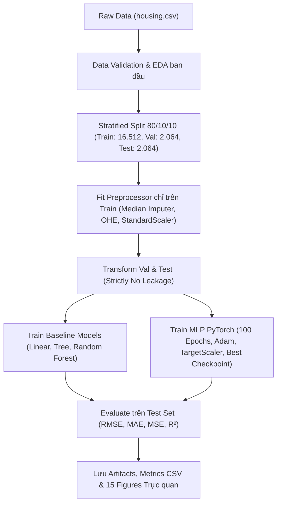

# Báo cáo Thực nghiệm Lab 4: Dự đoán Giá Nhà California (California Housing)

Dự án này là bài tập thực hành môn Học máy (Lab 4), tập trung xây dựng và đánh giá mô hình mạng nơ-ron nhiều tầng (Multi-Layer Perceptron - MLP) trên nền tảng **PyTorch** cho bài toán hồi quy (regression) dự đoán giá nhà. Để đánh giá hiệu quả một cách khách quan và khoa học, mô hình MLP được đối sánh trực tiếp với ba mô hình đường cơ sở (baseline): **Linear Regression**, **Decision Tree Regressor** và **Random Forest Regressor**.

Toàn bộ mã nguồn được tổ chức theo cấu trúc module sản phẩm (`src/`), đi kèm bộ kiểm thử tự động (`tests/`, 48 tests passing) và ba Jupyter Notebook phục vụ mục đích trình bày trực quan từng giai đoạn nghiên cứu.

---

## 1. TỔNG QUAN DỰ ÁN (Project Overview)

- **Bài toán:** Hồi quy giá trị nhà trung vị (`median_house_value`) dựa trên các đặc trưng nhân khẩu, kinh tế và vị trí địa lý của từng cụm dân cư tại bang California (theo số liệu điều tra dân số năm 1990).
- **Mục tiêu thực nghiệm:**
  1. Xây dựng đường ống dữ liệu (data pipeline) hoàn chỉnh, độc lập và chống rò rỉ thông tin (data leakage).
  2. Triển khai mô hình MLP bằng PyTorch với cơ chế chuẩn hóa biến mục tiêu (target scaling) và checkpointing.
  3. Xây dựng các mô hình baseline từ đơn giản đến phức tạp làm chuẩn so sánh.
  4. Đánh giá đa chiều bằng 4 độ đo hồi quy chuẩn: $RMSE$, $MAE$, $MSE$ và $R^2$.
- **Đối tượng phục vụ:** Báo cáo bài tập lớn, tài liệu tham khảo cho việc chuyển đổi mã từ notebook sang kiến trúc phần mềm máy học có khả năng tái lập (reproducible ML pipeline).

---

## 2. KIẾN TRÚC HỆ THỐNG VÀ QUY TRÌNH (System Architecture & Pipeline)

### 2.1 Cấu trúc thư mục mã nguồn
```text
Lab_4 Predicting House Prices/
├── data/
│   ├── raw/housing.csv                   # Tập dữ liệu thô ban đầu (20.640 dòng)
│   └── processed/                        # Dữ liệu phân tách train/val/test
├── docs/                                 # Tài liệu thiết kế và đối chiếu bài giảng
├── notebooks/
│   ├── 01_eda_and_preprocessing.ipynb    # Khám phá dữ liệu và tiền xử lý
│   ├── 02_mlp_model_training.ipynb       # Huấn luyện baseline và MLP PyTorch
│   └── 03_baseline_and_comparison.ipynb  # Đánh giá, đối sánh và suy luận mẫu
├── results/
│   ├── figures/                          # 15 biểu đồ trực quan (5 EDA + 10 mô hình)
│   ├── metrics/                          # Bảng tổng hợp chỉ số CSV
│   └── saved_models/                     # Model weights (.pt, .joblib) & preprocessor
├── src/                                  # Module mã nguồn chuẩn hóa
│   ├── config.py                         # Thiết lập tham số và đường dẫn
│   ├── data/                             # Nạp, phân tách và tiền xử lý dữ liệu
│   ├── features/                         # Kỹ thuật sinh đặc trưng phái sinh
│   ├── models/                           # Định nghĩa MLP PyTorch và baseline
│   ├── evaluation/                       # Tính metric và xuất biểu đồ
│   └── utils/                            # Logging và thiết lập seed tái lập
├── tests/                                # 48 unit/integration tests tự động
├── main.py                               # Entrypoint chạy toàn bộ pipeline
└── requirements.txt                      # Danh mục thư viện phụ thuộc
```

### 2.2 Sơ đồ luồng xử lý (Data & Modeling Workflow)


---

## 3. KHÁM PHÁ VÀ PHÂN TÍCH DỮ LIỆU (Exploratory Data Analysis - EDA)

Tập dữ liệu thô bao gồm **20.640 bản ghi** và **10 thuộc tính**. Toàn bộ phân tích EDA được thực hiện nghiêm ngặt trên tập huấn luyện (16.512 bản ghi) sau khi đã phân tách dữ liệu để tránh thiên kiến nhận thức.

### 3.1 Đặc điểm của các thuộc tính
1. **Giá trị khuyết thiếu:** Cột `total_bedrooms` bị khuyết 207 bản ghi (chiếm khoảng 1% dữ liệu). Cần dùng phép điền trung vị (`median`) dựa trên phân bố lệch phải.
2. **Biến phân loại (`ocean_proximity`):** Gồm 5 nhãn: `<1H OCEAN`, `INLAND`, `NEAR OCEAN`, `NEAR BAY` và `ISLAND`. Trong đó `ISLAND` chỉ có 5 mẫu trong toàn bộ tập dữ liệu. Bộ mã hóa cần thiết lập `handle_unknown='ignore'` để tránh lỗi khi gặp nhãn hiếm ở tập kiểm thử.
3. **Hiện tượng giới hạn trần (Target Capping):** Biến mục tiêu `median_house_value` bị chặn trên ở mức **500.001 USD** với **965 bản ghi** tập trung tại giá trị này. Đây là đặc tính thu thập khảo sát năm 1990 cần lưu ý khi diễn giải sai số ở phân khúc nhà cao cấp.

### 3.2 Các biểu đồ trực quan hóa EDA (Lưu trữ tại `results/figures/`)
- [eda_feature_distributions.png](file:///e:/Hoc_May_Tren_truong/Lab_4%20Predicting%20House%20Prices/results/figures/eda_feature_distributions.png): Phân bố histogram và KDE của 8 biến số cho thấy đa số các biến quy mô phòng và dân số có độ lệch phải (skewness) cao.
- [eda_geographical_scatter.png](file:///e:/Hoc_May_Tren_truong/Lab_4%20Predicting%20House%20Prices/results/figures/eda_geographical_scatter.png): Tọa độ địa lý (kinh độ, vĩ độ) kết hợp mật độ dân số và mức giá cho thấy các cụm nhà có giá trị cao tập trung rõ nét dọc theo dải bờ biển và các đô thị lớn (vùng vịnh San Francisco và Los Angeles).
- [eda_correlation_heatmap.png](file:///e:/Hoc_May_Tren_truong/Lab_4%20Predicting%20House%20Prices/results/figures/eda_correlation_heatmap.png): Ma trận tương quan Pearson chỉ ra `median_income` là thuộc tính tương quan thuận mạnh nhất với giá nhà ($r \approx 0.69$).
- [eda_target_distribution.png](file:///e:/Hoc_May_Tren_truong/Lab_4%20Predicting%20House%20Prices/results/figures/eda_target_distribution.png): Trực quan hóa giá trị trung vị của ngôi nhà với đỉnh đột biến tại mốc 500.001 USD.
- [eda_categorical_distribution.png](file:///e:/Hoc_May_Tren_truong/Lab_4%20Predicting%20House%20Prices/results/figures/eda_categorical_distribution.png): Biểu đồ tần suất nhóm vị trí biển và phân bố giá nhà theo từng nhóm, thể hiện rõ nhà vùng `INLAND` có mức giá trung bình thấp hơn đáng kể so với các vùng sát biển.

---

## 4. TIỀN XỬ LÝ VÀ KỸ THUẬT TÍNH NĂNG (Preprocessing & Feature Engineering)

### 4.1 Quy trình phân chia dữ liệu (Data Splitting)
Dữ liệu được phân chia theo tỷ lệ **80% Train : 10% Validation : 10% Test** bằng kỹ thuật phân tầng (stratified sampling) trên các khoảng thu nhập (`income_cat`) thông qua `pd.qcut`:
- **Tập huấn luyện (Train):** 16.512 bản ghi.
- **Tập kiểm định (Validation):** 2.064 bản ghi (dùng chọn mô hình và lưu checkpoint).
- **Tập kiểm thử độc lập (Test):** 2.064 bản ghi (chỉ dùng một lần duy nhất để báo cáo cuối cùng).

### 4.2 Đường ống biến đổi đặc trưng (Feature Transformation)
Toàn bộ quá trình tiền xử lý được đóng gói trong `sklearn.compose.ColumnTransformer`:
- **Đặc trưng dạng số (8 cột):** Xử lý giá trị khuyết bằng `SimpleImputer(strategy='median')`, sau đó chuẩn hóa thang đo bằng `StandardScaler()`.
- **Đặc trưng phân loại (1 cột `ocean_proximity`):** Điền khuyết bằng `SimpleImputer(strategy='most_frequent')`, sau đó mã hóa one-hot bằng `OneHotEncoder(handle_unknown='ignore', sparse_output=False)`.
- **Tổng số chiều sau tiền xử lý:** 13 đặc trưng dạng số đầu vào cho mô hình.

> **Nguyên tắc chống rò rỉ thông tin:** Bộ tiền xử lý chỉ được gọi lệnh `.fit()` trên `X_train`. Các tập `X_val`, `X_test` và dữ liệu suy luận mới chỉ được gọi lệnh `.transform()`. Toàn bộ đối tượng preprocessor được tuần tự hóa vào [results/saved_models/preprocessor.joblib](file:///e:/Hoc_May_Tren_truong/Lab_4%20Predicting%20House%20Prices/results/saved_models/preprocessor.joblib).

---

## 5. MÔ HÌNH HÓA VÀ HUẤN LUYỆN (Modeling & Training)

### 5.1 Các mô hình đường cơ sở (Baseline Models)
Tuân thủ kỷ luật ML "luôn bắt đầu bằng mô hình đơn giản trước khi dùng mạng nơ-ron":
1. **Linear Regression:** Mô hình tuyến tính cơ bản giải bằng nghiệm đóng (Ordinary Least Squares), phục vụ làm mốc sàn hiệu năng.
2. **Decision Tree Regressor:** Mô hình phi tuyến dạng cây quyết định với ràng buộc độ sâu `max_depth=5` để hạn chế hiện tượng quá khớp (overfitting).
3. **Random Forest Regressor:** Mô hình tổ hợp rừng ngẫu nhiên với `n_estimators=100`, `random_state=42`, đại diện cho nhóm phương pháp ensemble mạnh trên dữ liệu bảng.

### 5.2 Mô hình mạng nơ-ron nhiều tầng (PyTorch MLP)
- **Kiến trúc mạng (`PyTorchHousePriceMLP`):**
  - Lớp ẩn 1: Tuyến tính $13 \to 32$, hàm kích hoạt ReLU.
  - Lớp ẩn 2: Tuyến tính $32 \to 16$, hàm kích hoạt ReLU.
  - Lớp đầu ra: Tuyến tính $16 \to 1$ (dự đoán giá trị vô hướng liên tục).
- **Cơ chế Target Scaling:** Trong bài toán hồi quy với giá nhà biên độ dao động lớn (hàng trăm nghìn USD), nếu đưa trực tiếp target vào tính loss, gradient sẽ rất lớn và làm mất ổn định quá trình tối ưu. Dự án sử dụng `TargetScaler` (chuẩn hóa $y$ về phân phối chuẩn có $\mu=0, \sigma=1$ dựa trên `y_train`).
- **Chiến lược tối ưu:**
  - Hàm mất mát: Mean Squared Error (MSE Loss) trên không gian chuẩn hóa.
  - Thuật toán tối ưu: Adam với tốc độ học $\text{learning\_rate} = 0.001$.
  - Batch size: 32 mẫu mỗi mini-batch.
  - Số epochs: 100 epochs.
  - Lưu checkpoint: Tự động ghi nhận trọng số mạng tại epoch đạt MSE thấp nhất trên tập validation và nạp lại khi đánh giá cuối cùng.

---

## 6. KẾT QUẢ THỰC NGHIỆM VÀ SO SÁNH (Experimental Results & Benchmark)

Toàn bộ các mô hình được đánh giá trên cùng tập kiểm thử độc lập gồm **2.064 bản ghi** chưa từng xuất hiện trong quá trình huấn luyện và chọn siêu tham số. Kết quả được trích xuất từ file [results/metrics/model_performance_summary.csv](file:///e:/Hoc_May_Tren_truong/Lab_4%20Predicting%20House%20Prices/results/metrics/model_performance_summary.csv):

### 6.1 Bảng tổng hợp hiệu năng trên tập kiểm thử (Test Set, N = 2.064)

| Mô hình (Model) | RMSE (USD) | MAE (USD) | MSE (USD²) | Hệ số xác định $R^2$ |
| :--- | :---: | :---: | :---: | :---: |
| **Random Forest Regressor** | **47.930** | **31.299** | **2,30 × 10⁹** | **82,55%** |
| **PyTorch MLP (32-16-1)** | 51.403 | 35.367 | 2,64 × 10⁹ | 79,93% |
| **Linear Regression** | 66.684 | 49.482 | 4,45 × 10⁹ | 66,22% |
| **Decision Tree (depth=5)** | 70.064 | 49.789 | 4,91 × 10⁹ | 62,71% |

### 6.2 Bảng tổng hợp hiệu năng trên tập kiểm định (Validation Set, N = 2.064)

| Mô hình (Model) | RMSE (USD) | MAE (USD) | MSE (USD²) | Hệ số xác định $R^2$ |
| :--- | :---: | :---: | :---: | :---: |
| **Random Forest Regressor** | **50.475** | **32.535** | **2,55 × 10⁹** | **80,74%** |
| **PyTorch MLP (32-16-1)** | 55.288 | 36.551 | 3,06 × 10⁹ | 76,89% |
| **Linear Regression** | 70.627 | 51.523 | 4,99 × 10⁹ | 62,30% |
| **Decision Tree (depth=5)** | 71.364 | 50.369 | 5,09 × 10⁹ | 61,50% |

### 6.3 Nhận xét kỹ thuật dựa trên số liệu
1. **Random Forest đạt kết quả tốt nhất:** Với $R^2 = 82,55\%$ và $RMSE \approx 47.930\text{ USD}$, mô hình ensemble cây quyết định thể hiện ưu thế vượt trội trong việc nắm bắt các mối quan hệ phân mảnh và ngưỡng địa lý phi tuyến tính trên dữ liệu bảng.
2. **Khả năng học của PyTorch MLP:** Đạt $R^2 = 79,93\%$ và $RMSE \approx 51.403\text{ USD}$. Mạng nơ-ron cải thiện rất đáng kể so với Linear Regression ($+13,71\%$ về $R^2$, giảm hơn 15.000 USD sai số RMSE), chứng minh các tầng phi tuyến ReLU đã học tốt các tổ hợp đặc trưng phức tạp.
3. **Mô hình tuyến tính và cây đơn lẻ:** Cả Linear Regression ($R^2 = 66,22\%$) và Decision Tree độ sâu 5 ($R^2 = 62,71\%$) đều cho sai số tương đối cao ($RMSE > 66.000\text{ USD}$), cho thấy quan hệ giữa tọa độ địa lý, thu nhập và giá nhà có tính phi tuyến mạnh mẽ mà một siêu phẳng hay một vài nhát cắt đơn giản không thể mô tả trọn vẹn.

---

## 7. PHÂN TÍCH SAI SỐ VÀ GIỚI HẠN (Error Analysis & Limitations)

### 7.1 Phân tích đồ thị đánh giá (Lưu trữ tại `results/figures/`)
- [loss_curve.png](file:///e:/Hoc_May_Tren_truong/Lab_4%20Predicting%20House%20Prices/results/figures/loss_curve.png): Đồ thị theo dõi Train Loss và Validation Loss (đơn vị USD²) cùng MAE qua 100 epochs. Quá trình hội tụ diễn ra ổn định sau 40 epochs mà không gặp hiện tượng phân kỳ (divergence).
- [model_comparison_bar.png](file:///e:/Hoc_May_Tren_truong/Lab_4%20Predicting%20House%20Prices/results/figures/model_comparison_bar.png): Biểu đồ cột so sánh trực tiếp RMSE và MAE của bốn mô hình, thể hiện trực quan khoảng cách hiệu năng giữa nhóm baseline đơn giản và nhóm mô hình phức tạp.
- **Đồ thị Giá thực tế so với Dự đoán (Actual vs. Predicted):**
  - [mlp_pytorch_actual_vs_predicted.png](file:///e:/Hoc_May_Tren_truong/Lab_4%20Predicting%20House%20Prices/results/figures/mlp_pytorch_actual_vs_predicted.png)
  - [random_forest_actual_vs_predicted.png](file:///e:/Hoc_May_Tren_truong/Lab_4%20Predicting%20House%20Prices/results/figures/random_forest_actual_vs_predicted.png)
  - [linear_regression_actual_vs_predicted.png](file:///e:/Hoc_May_Tren_truong/Lab_4%20Predicting%20House%20Prices/results/figures/linear_regression_actual_vs_predicted.png)
  - [decision_tree_actual_vs_predicted.png](file:///e:/Hoc_May_Tren_truong/Lab_4%20Predicting%20House%20Prices/results/figures/decision_tree_actual_vs_predicted.png)
- **Đồ thị Phân tích phần dư (Residuals Plot):**
  - [mlp_pytorch_residuals.png](file:///e:/Hoc_May_Tren_truong/Lab_4%20Predicting%20House%20Prices/results/figures/mlp_pytorch_residuals.png)
  - [random_forest_residuals.png](file:///e:/Hoc_May_Tren_truong/Lab_4%20Predicting%20House%20Prices/results/figures/random_forest_residuals.png)
  - [linear_regression_residuals.png](file:///e:/Hoc_May_Tren_truong/Lab_4%20Predicting%20House%20Prices/results/figures/linear_regression_residuals.png)
  - [decision_tree_residuals.png](file:///e:/Hoc_May_Tren_truong/Lab_4%20Predicting%20House%20Prices/results/figures/decision_tree_residuals.png)

### 7.2 Các hạn chế còn tồn tại của mô hình
1. **Thiên kiến do Capping giá trị 500.001 USD:** Quan sát biểu đồ Actual vs. Predicted cho thấy một dải ngang các điểm thực tế tại mốc 500.001 USD nhưng mô hình dự đoán trải rộng từ 300.000 đến trên 500.000 USD. Do dữ liệu khảo sát bị cắt ngọn, mô hình học xu hướng hồi quy về trung bình và luôn đánh giá thấp (underpredict) các ngôi nhà đắt tiền ở mốc này.
2. **Phương sai phần dư tăng dần (Heteroscedasticity):** Biểu đồ Residuals cho thấy ở các căn nhà có giá trị dưới 200.000 USD, độ phân tán phần dư tương đối đồng đều quanh trục 0. Khi giá nhà vượt 350.000 USD, biên độ sai số mở rộng đáng kể.
3. **Giới hạn mẫu cực ít (`ISLAND`):** Nhóm đảo chỉ có 5 bản ghi trong tổng số 20.640 dòng, dẫn tới việc mô hình chưa có đủ bằng chứng thống kê để dự báo chính xác giá nhà thuộc khu vực này.

---

## 8. THỬ NGHIỆM INFERENCE VỚI DỮ LIỆU MẪU (Sample Inference Demo)

Hệ thống cung cấp chức năng suy luận độc lập (`sample_inference`) nạp lại mô hình đã lưu cùng bộ tiền xử lý để dự đoán trên các mẫu kiểm thử ngẫu nhiên. Trích đoạn kết quả từ [results/metrics/sample_predictions.csv](file:///e:/Hoc_May_Tren_truong/Lab_4%20Predicting%20House%20Prices/results/metrics/sample_predictions.csv):

| Chỉ số mẫu | Giá thực tế (USD) | MLP PyTorch (USD) | Random Forest (USD) | Linear Reg (USD) | Sai số tuyệt đối MLP |
| :---: | :---: | :---: | :---: | :---: | :---: |
| **Mẫu #1** | **48.300** | 63.818 | 54.020 | 50.150 | +15.518 USD |
| **Mẫu #2** | **141.700** | 162.290 | 148.910 | 179.721 | +20.590 USD |
| **Mẫu #3** | **500.001** | 440.161 | 473.840 | 382.492 | -59.840 USD |

*Nhận xét:* Với các mẫu ở tầm giá thấp và trung bình (mẫu #1, #2), sai số tương đối dao động từ 10% đến 25%. Đối với mẫu #3 chạm trần trần khảo sát (500.001 USD), cả ba mô hình đều có xu hướng dự đoán thấp hơn giá thực tế do ảnh hưởng của trần dữ liệu.

---

## 9. HỆ THỐNG KIỂM THỬ TỰ ĐỘNG (Automated Test Suite)

Dự án được bảo vệ bởi bộ kiểm thử tự động toàn diện viết trên nền tảng `pytest`. Bộ test đảm bảo tính đúng đắn toán học, tính ổn định dữ liệu và tính tương thích khi nạp/lưu mô hình.

```bash
pytest -v
```

### Danh mục các ca kiểm thử (48 passed)
- [tests/test_data.py](file:///e:/Hoc_May_Tren_truong/Lab_4%20Predicting%20House%20Prices/tests/test_data.py): Kiểm tra việc nạp dữ liệu, kiểm tra tính toàn vẹn phân tách 80/10/10, đảm bảo không có rò rỉ mẫu giữa các tập, và kiểm thử tính năng tiền xử lý với dữ liệu có giá trị khuyết hoặc nhãn phân loại mới.
- [tests/test_features.py](file:///e:/Hoc_May_Tren_truong/Lab_4%20Predicting%20House%20Prices/tests/test_features.py): Kiểm thử module sinh thuộc tính bổ sung (`HousingFeatureEngineer`), xác minh các công thức tính tỷ lệ phòng và tính toán kích thước hộ gia đình.
- [tests/test_models.py](file:///e:/Hoc_May_Tren_truong/Lab_4%20Predicting%20House%20Prices/tests/test_models.py): Kiểm tra kiến trúc mạng nơ-ron PyTorch, luồng lan truyền xuôi (forward pass), chức năng chuẩn hóa và giải chuẩn hóa của `TargetScaler`, cùng tính đúng đắn của việc lưu và nạp checkpoint PyTorch (`.pt`) cũng như baseline (`.joblib`).
- [tests/test_evaluation.py](file:///e:/Hoc_May_Tren_truong/Lab_4%20Predicting%20House%20Prices/tests/test_evaluation.py): Kiểm thử độ chính xác các hàm tính metric ($MSE, RMSE, MAE, R^2$) với các bộ dữ liệu đồ chơi đối chiếu công thức giải tích.
- [tests/test_visualization.py](file:///e:/Hoc_May_Tren_truong/Lab_4%20Predicting%20House%20Prices/tests/test_visualization.py): Xác thực tính năng xuất đủ 15 biểu đồ (5 biểu đồ EDA + 10 biểu đồ mô hình), kiểm tra định dạng file PNG hợp lệ mà không làm rò rỉ vùng nhớ Matplotlib.
- [tests/test_pipeline.py](file:///e:/Hoc_May_Tren_truong/Lab_4%20Predicting%20House%20Prices/tests/test_pipeline.py): Kiểm thử luồng tích hợp toàn trình (end-to-end integration test) từ dữ liệu thô tới sinh file kết quả và thực hiện suy luận.

---

## 10. HƯỚNG DẪN CÀI ĐẶT VÀ CHẠY THỰC NGHIỆM (Getting Started)

### 10.1 Khởi tạo môi trường
Yêu cầu hệ thống: Python phiên bản từ 3.10 trở lên.
```bash
# Tạo môi trường ảo
python -m venv .venv_lab

# Kích hoạt môi trường (Windows PowerShell)
.\.venv_lab\Scripts\Activate.ps1

# Nâng cấp pip và cài đặt thư viện phụ thuộc
pip install --upgrade pip
pip install -r requirements.txt
```

### 10.2 Chạy toàn bộ đường ống thực nghiệm (Main Pipeline)
Để chạy toàn bộ quy trình từ tiền xử lý, huấn luyện 4 mô hình, đánh giá, lưu checkpoint và xuất toàn bộ 15 biểu đồ:
```bash
python main.py
```
*Tùy chọn bổ sung:*
- Chạy nhanh kiểm thử tham số (ít epoch): `python main.py --epochs 5 --quick-test`
- Bỏ qua bước vẽ biểu đồ để tăng tốc: `python main.py --skip-plots`

### 10.3 Chạy bộ kiểm thử (Unit Tests)
```bash
pytest
```

### 10.4 Làm việc với Jupyter Notebooks
Nếu muốn theo dõi trực quan và tương tác từng bước:
```bash
jupyter lab
```
Chạy tuần tự các notebook trong thư mục `notebooks/`:
1. [notebooks/01_eda_and_preprocessing.ipynb](file:///e:/Hoc_May_Tren_truong/Lab_4%20Predicting%20House%20Prices/notebooks/01_eda_and_preprocessing.ipynb): Phân tích phân bố, tương quan và tiền xử lý dữ liệu.
2. [notebooks/02_mlp_model_training.ipynb](file:///e:/Hoc_May_Tren_truong/Lab_4%20Predicting%20House%20Prices/notebooks/02_mlp_model_training.ipynb): Huấn luyện các mô hình baseline và mạng MLP PyTorch.
3. [notebooks/03_baseline_and_comparison.ipynb](file:///e:/Hoc_May_Tren_truong/Lab_4%20Predicting%20House%20Prices/notebooks/03_baseline_and_comparison.ipynb): Đánh giá kiểm thử, so sánh đối chuẩn và thử nghiệm suy luận mẫu.

---

## 11. BÀI HỌC VÀ ĐỊNH HƯỚNG CẢI TIẾN (Lessons Learned & Future Work)

### 11.1 Bài học rút ra từ thực nghiệm
1. **Dữ liệu bảng và mạng nơ-ron:** Mạng MLP với hai lớp ẩn hoạt động rất hiệu quả ($R^2 \approx 80\%$) nhưng vẫn xếp sau Random Forest ($R^2 \approx 82,5\%$). Điều này khẳng định đặc thù kinh điển của học máy: đối với dữ liệu dạng bảng có số lượng mẫu vừa phải, các mô hình cây tổ hợp (ensemble trees) thường có khả năng khai thác các mặt phẳng phân tách trực giao tốt hơn so với mạng nơ-ron truyền thống nếu không qua các kỹ thuật kiến trúc phức tạp.
2. **Tầm quan trọng của Target Scaling:** Việc chuẩn hóa biến mục tiêu cho mạng nơ-ron trong bài toán hồi quy giá trị lớn là yếu tố quyết định giúp hàm mất mát hội tụ ổn định, tránh hiện tượng gradient biến mất hoặc bùng nổ.
3. **Kỷ luật ngăn ngừa Data Leakage:** Việc tách tập kiểm thử và chỉ thực hiện `fit` trên tập huấn luyện là bắt buộc. Nếu thực hiện điền khuyết hay chuẩn hóa trên toàn bộ dữ liệu trước khi chia, các chỉ số đánh giá sẽ bị lạc quan quá mức (optimistic bias) và không phản ánh chính xác khả năng tổng quát hóa thực tế.

### 11.2 Định hướng cải tiến mở rộng
- **Kỹ thuật tính năng nâng cao:** Kích hoạt và tinh chỉnh các thuộc tính tỷ lệ phòng (`rooms_per_household`, `bedrooms_per_room`) hoặc áp dụng kỹ thuật phân cụm tọa độ địa lý (K-Means Spatial Clustering) để tạo đặc trưng cụm kinh tế.
- **Thử nghiệm các thuật toán Boosting:** Bổ sung LightGBM hoặc XGBoost vào bảng đối chuẩn để so sánh hiệu năng và tốc độ tính toán với Random Forest.
- **Tối ưu siêu tham số tự động:** Sử dụng thư viện Optuna để tinh chỉnh số nơ-ron, tỷ lệ dropout, learning rate và weight decay cho mô hình PyTorch MLP.

---

## 12. THAM KHẢO VÀ NGUỒN DỮ LIỆU (References)

1. **Bộ dữ liệu California Housing:** Pace, R. Kelley, and Ronald Barry. *"Sparse spatial autoregressions."* Statistics & Probability Letters 33.3 (1997): 291-297.
2. **Tài liệu hướng dẫn bài tập:** `docs/Practice exercise 4.pdf` và các tài liệu thiết kế hệ thống tại [docs/design.md](file:///e:/Hoc_May_Tren_truong/Lab_4%20Predicting%20House%20Prices/docs/design.md), [docs/lecture_alignment.md](file:///e:/Hoc_May_Tren_truong/Lab_4%20Predicting%20House%20Prices/docs/lecture_alignment.md).
3. **PyTorch Documentation:** PyTorch Tutorials on Neural Networks, Optimization and Datasets/DataLoaders (Official Documentation).
4. **Scikit-learn Documentation:** Feature Preprocessing Pipelines and Ensemble Methods (Pedregosa et al., JMLR 2011).
