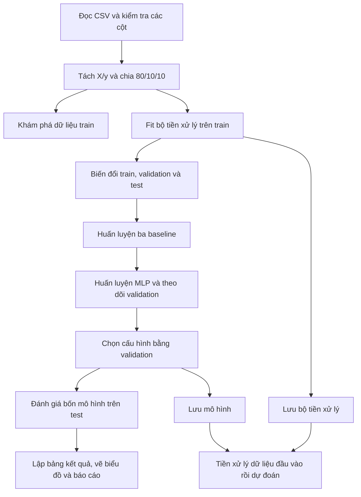

# Thiết kế bài thực hành dự đoán giá nhà theo 5W1H

## 1. Yêu cầu của bài thực hành

Tài liệu dựa trên [Practice exercise 4.pdf](<Practice exercise 4.pdf>). Bài thực hành yêu cầu xây dựng MLP để dự đoán giá nhà, sau đó so sánh với Linear Regression, Decision Tree và Random Forest. Dữ liệu đầu vào nằm trong `data/raw/housing.csv`.

| Phần trong đề | Yêu cầu | Cách thực hiện |
| --- | --- | --- |
| Task 1 | Import các thư viện cần thiết | Khai báo thư viện trong `requirements.txt`; viết các hàm dùng chung trong `src/` |
| Task 2 | Chuẩn bị dữ liệu, tách X/y và chuẩn hóa | Chia dữ liệu trước, sau đó điền giá trị thiếu, mã hóa biến phân loại và chuẩn hóa biến số |
| Task 3 | Xây dựng mạng Sequential với các lớp Dense | Dùng kiến trúc `32 ReLU → 16 ReLU → 1 linear`, Adam và MSE loss |
| Task 4 | Huấn luyện và theo dõi MSE, MAE | Chạy 100 epochs với batch size 32; theo dõi train và validation |
| Task 5 | Đánh giá và so sánh giá thực tế với dự đoán | Tính chỉ số trên test, vẽ biểu đồ và phân tích sai số |
| Task 6 | So sánh MLP với ba mô hình regression | Huấn luyện baseline trước MLP và đánh giá cả bốn mô hình trên cùng test |

### Những điểm điều chỉnh so với đề

Đề sử dụng Boston Housing và minh họa cách chia train/test theo tỷ lệ 80/20. Thiết kế này chọn California Housing và chia train/validation/test theo tỷ lệ 80/10/10. Tập validation riêng giúp theo dõi quá trình huấn luyện mà vẫn giữ test cho lần đánh giá cuối.

| Nội dung | Trong đề | Lựa chọn thiết kế |
| --- | --- | --- |
| Dữ liệu | Boston Housing | California Housing từ CSV trên máy |
| Chia tập | Train/test 80/20, seed 42 | Train/validation/test 80/10/10, seed 42 |
| Validation | Ví dụ dùng test làm validation | Dùng tập validation riêng |
| Chỉ số | MSE, MAE; Task 6 có thêm R² | MSE, MAE, R² và RMSE để diễn giải sai số theo USD |
| Learning rate | Chỉ nêu Adam | Chọn `0.001` |
| Baseline | Không quy định độ sâu hoặc số cây | Decision Tree dùng `max_depth=5`; Random Forest dùng `n_estimators=100` |

Báo cáo cần giải thích các điều chỉnh này. Đề không quy định mức MAE hoặc R² phải đạt, nên kết luận cần dựa trên kết quả thực nghiệm và so sánh giữa các mô hình.

## 2. What — Bài toán cần giải quyết là gì?

Bài toán là dự đoán `median_house_value` từ chín đặc trưng của California Housing. Đây là bài toán **regression**, có đầu ra là một giá trị liên tục theo USD. Target biểu thị giá nhà trung vị của một khu vực, không phải giá giao dịch của từng căn nhà.

### Dữ liệu đầu vào

| Loại dữ liệu | Các cột |
| --- | --- |
| Tám biến số | `longitude`, `latitude`, `housing_median_age`, `total_rooms`, `total_bedrooms`, `population`, `households`, `median_income` |
| Một biến phân loại | `ocean_proximity` |
| Giá trị cần dự đoán | `median_house_value` |

Kiểm tra trực tiếp CSV cho thấy dữ liệu có 20.640 dòng. Cột `total_bedrooms` thiếu 207 giá trị; `ocean_proximity` có năm nhóm, trong đó `ISLAND` chỉ có năm dòng. Target lớn nhất là 500001 USD, xuất hiện ở 965 dòng. Cần xem xét các đặc điểm này khi tiền xử lý và phân tích sai số; nếu thay CSV thì kiểm tra lại thống kê.

### Kết quả cần có

- Ba file CSV chứa train, validation và test, bao gồm cả target.
- Bộ tiền xử lý đã fit trên train, ba baseline và MLP đã huấn luyện.
- Bảng MSE, RMSE, MAE và R² của bốn mô hình trên cùng test.
- Biểu đồ quá trình học, giá thực tế so với dự đoán và so sánh mô hình.
- Notebook giải thích cách làm, nhận xét kết quả và minh họa dự đoán với ba mẫu test.

Target được giữ nguyên đơn vị USD. Feature engineering là phần mở rộng, chưa dùng trong quy trình chính. Phạm vi bài tập tập trung vào dữ liệu, mô hình và đánh giá; không bao gồm xây dựng web/API, triển khai lên cloud, stacking hoặc bổ sung các thư viện boosting.

## 3. Why — Vì sao chọn cách làm này?

Mục tiêu là hiểu cách chuẩn bị dữ liệu, xây dựng MLP và đánh giá mô hình regression. Các baseline cung cấp kết quả tham chiếu để xem MLP có mang lại cải thiện hay không.

| Lựa chọn | Lý do | Điểm cần lưu ý |
| --- | --- | --- |
| Bắt đầu bằng Linear Regression | Dễ giải thích, chạy nhanh và giúp kiểm tra toàn bộ quy trình | Có thể chưa học được quan hệ phi tuyến |
| Tách validation khỏi test | Chọn cấu hình mà vẫn giữ test độc lập | Kết quả phụ thuộc vào cách chia; test chỉ chiếm 10% dữ liệu |
| Chỉ fit tiền xử lý trên train | Tránh để thông tin validation/test ảnh hưởng đến mô hình | Cần xử lý nhóm phân loại chưa gặp trong train |
| Dùng chung bộ tiền xử lý | Giúp bốn mô hình nhận cùng đầu vào | Mô hình cây không cần scaling nhưng vẫn dùng để thống nhất quy trình |
| Giữ target theo USD | MAE và RMSE dễ diễn giải | Thang target lớn có thể khiến MLP hội tụ chậm |
| Chia code thành module | Dễ phân công, kiểm thử và dùng lại trong notebook | Notebook và chương trình chính phải thống nhất đầu vào, đầu ra |

Nếu baseline tốt hơn MLP, báo cáo cần nêu kết quả và phân tích nguyên nhân. Các thử nghiệm biến đổi target, đổi kiến trúc hoặc tạo thêm đặc trưng cần có kế hoạch đánh giá trên validation và được thống nhất trước khi mở rộng phạm vi.

## 4. Who — Ai sử dụng và ai thực hiện?

Tài liệu phục vụ nhóm sinh viên làm bài và giảng viên đánh giá kết quả. Công việc được chia theo vai trò để các phần có thể ghép lại thành một quy trình thống nhất.

| Vai trò | Công việc | Kết quả bàn giao |
| --- | --- | --- |
| Nhóm dữ liệu | Quản lý cấu hình, đọc CSV, chia tập, tiền xử lý và viết notebook 01; thử thêm đặc trưng khi cần | Các tập dữ liệu, bộ tiền xử lý và kết quả kiểm tra |
| Nhóm mô hình | Huấn luyện baseline, MLP, lưu/nạp mô hình và viết notebook 02 | Mô hình, bộ tiền xử lý tương ứng và lịch sử huấn luyện |
| Nhóm đánh giá | Tính chỉ số, vẽ biểu đồ, ghi log, điều phối chương trình và viết notebook 03 | Bảng so sánh, biểu đồ, nhận xét và ví dụ dự đoán |
| Cả nhóm | Ghép các phần và kiểm thử trong `tests/test_pipeline.py` | Quy trình chạy đầy đủ từ dữ liệu đầu vào đến dự đoán |

Notebook gọi các hàm trong `src/` để dùng chung cách xử lý. Mô hình cần đi kèm đúng bộ tiền xử lý của lần huấn luyện đó; dùng nhầm bộ tiền xử lý có thể làm sai dự đoán dù số cột vẫn khớp.

## 5. Where — Chương trình chạy ở đâu và dữ liệu được lưu thế nào?

Chương trình chạy trên máy bằng Python. Có thể chạy toàn bộ quy trình qua `main.py` hoặc chạy các notebook theo thứ tự 01 → 02 → 03. Dữ liệu được đọc từ `data/raw/housing.csv`; chương trình cần báo lỗi nếu thiếu file hoặc các cột không đúng yêu cầu.

`src/config.py` quản lý đường dẫn tính từ thư mục gốc. Các thư mục kết quả được tạo khi chạy chương trình, không tạo chỉ vì import config. Trước khi triển khai, cần thống nhất thư viện và phiên bản cho code, notebook và kiểm thử.

### Cấu trúc thư mục dự kiến (target structure)

Mỗi thư mục phụ trách một phần công việc. Các mục có dấu `[generated]` là file hoặc kết quả được sinh khi chạy chương trình.

```text
Lab_4 Predicting House Prices/
├── main.py                             # Chạy lần lượt các bước và minh họa dự đoán
├── requirements.txt                    # Danh sách thư viện cần cài đặt
├── README.md                           # Giới thiệu bài toán và hướng dẫn chạy
├── AGENTS.md                           # Quy tắc làm việc trong dự án
├── docs/
│   ├── design.md                       # Thiết kế theo 5W1H và cấu trúc thư mục
│   └── Practice exercise 4.pdf          # Đề bài thực hành
├── data/
│   ├── raw/housing.csv                 # Dữ liệu California Housing đầu vào
│   └── processed/
│       ├── train.csv                   # [generated] Dữ liệu train và target, chưa tiền xử lý
│       ├── val.csv                     # [generated] Dữ liệu validation và target, chưa tiền xử lý
│       └── test.csv                    # [generated] Dữ liệu test và target, chưa tiền xử lý
├── src/
│   ├── __init__.py                     # Khai báo package mã nguồn
│   ├── config.py                       # Quản lý đường dẫn, cột dữ liệu và tham số mô hình
│   ├── data/
│   │   ├── __init__.py                 # Khai báo package xử lý dữ liệu
│   │   ├── loader.py                   # Đọc CSV, kiểm tra các cột và thống kê dữ liệu
│   │   └── preprocessing.py            # Chia tập, điền giá trị thiếu, mã hóa, chuẩn hóa và lưu CSV
│   ├── features/
│   │   ├── __init__.py                 # Khai báo package tạo đặc trưng
│   │   └── feature_engineering.py      # Tạo đặc trưng bổ sung; chưa bật trong quy trình chính
│   ├── models/
│   │   ├── __init__.py                 # Khai báo package mô hình
│   │   ├── baseline_models.py          # Huấn luyện và dự đoán bằng Linear Regression, Decision Tree, Random Forest
│   │   ├── mlp_model.py                # Xây dựng, huấn luyện, đánh giá và dự đoán bằng MLP
│   │   └── persistence.py              # Lưu và nạp lại các mô hình cùng bộ tiền xử lý
│   ├── evaluation/
│   │   ├── __init__.py                 # Khai báo package đánh giá
│   │   ├── metrics.py                  # Tính MSE, RMSE, MAE, R² và tổng hợp bảng so sánh
│   │   └── visualization.py            # Vẽ đường học, giá thực tế/dự đoán, phần dư và so sánh mô hình
│   └── utils/
│       ├── __init__.py                 # Khai báo package tiện ích dùng chung
│       └── logger.py                   # Thiết lập log và ghi tiến trình từng bước
├── notebooks/
│   ├── README.md                       # Hướng dẫn chạy các notebook theo thứ tự
│   ├── 01_eda_and_preprocessing.ipynb   # Khám phá dữ liệu train, chia tập và tiền xử lý
│   ├── 02_mlp_model_training.ipynb      # Huấn luyện baseline trước MLP, theo dõi và lưu mô hình
│   └── 03_baseline_and_comparison.ipynb # Nạp mô hình, đánh giá test và phân tích kết quả
├── tests/
│   ├── __init__.py                     # Khai báo package kiểm thử
│   ├── test_data.py                    # Kiểm tra đọc dữ liệu, chia tập và tiền xử lý
│   ├── test_features.py                # Kiểm tra cách tạo đặc trưng bổ sung
│   ├── test_models.py                  # Kiểm tra baseline, MLP và kích thước dự đoán
│   ├── test_evaluation.py              # Kiểm tra cách tính các chỉ số đánh giá
│   └── test_pipeline.py                # Kiểm tra toàn bộ quy trình và dự đoán sau khi lưu/nạp
├── results/
│   ├── saved_models/
│   │   ├── preprocessor.joblib         # [generated] Bộ tiền xử lý đã fit trên train
│   │   ├── baseline_models.joblib      # [generated] Ba mô hình baseline đã huấn luyện
│   │   └── mlp_house_price_model.keras # [generated] Mô hình MLP đã huấn luyện
│   ├── metrics/
│   │   └── model_performance_summary.csv # [generated] Bảng chỉ số của bốn mô hình trên test
│   └── figures/                        # [generated] Biểu đồ huấn luyện và đánh giá
└── logs/
    └── training.log                    # [generated] Nhật ký chạy và thông tin lỗi
```

`main.py` và các notebook gọi các module xử lý dữ liệu, huấn luyện và đánh giá. Các module dùng chung cấu hình, nhưng mỗi module chỉ thực hiện phần việc của mình: đọc dữ liệu, huấn luyện, đánh giá hoặc lưu kết quả.

## 6. When — Các bước được thực hiện theo thứ tự nào?

Mỗi giai đoạn cần đạt điều kiện trong bảng trước khi chuyển sang bước tiếp theo.

| Bước | Công việc | Điều kiện hoàn thành |
| --- | --- | --- |
| 1 | Thống nhất dữ liệu, chỉ số đánh giá, môi trường và file kết quả | Các nhóm hiểu rõ đầu vào, đầu ra và cách chạy |
| 2 | Đọc dữ liệu, chia 80/10/10 và khám phá train | Đúng cột, X/y khớp từng dòng, không trùng mẫu giữa các tập và chia lại được với cùng seed |
| 3 | Tiền xử lý và lưu dữ liệu | Chỉ fit trên train; xử lý được giá trị thiếu, nhóm mới và thứ tự cột |
| 4 | Huấn luyện Linear Regression, Decision Tree và Random Forest | Cả ba mô hình trả dự đoán đúng kích thước |
| 5 | Huấn luyện MLP với validation riêng | Có lịch sử huấn luyện, kiểm tra overfitting và dự đoán không chứa NaN hoặc vô cực |
| 6 | Chọn cấu hình bằng validation, lưu và nạp lại mô hình | Kết quả trước và sau khi lưu khớp nhau trong sai số cho phép |
| 7 | Đánh giá trên test | Có bảng so sánh bốn mô hình, biểu đồ và nhận xét |
| 8 | Hoàn thiện notebook và báo cáo | Chạy được theo thứ tự, giải thích lựa chọn thiết kế và giới hạn kết quả |

Baseline được huấn luyện trước MLP trong notebook 02. Notebook 03 nạp mô hình để đánh giá và so sánh trên test.

## 7. How — Xử lý dữ liệu, huấn luyện và đánh giá mô hình như thế nào?

### 7.1. Quy trình chung



Validation và test được biến đổi bằng bộ tiền xử lý đã fit trên train. Kết quả test chỉ dùng để đánh giá cuối, không dùng để chọn đặc trưng, điều chỉnh tham số hoặc quyết định dừng huấn luyện.

### 7.2. Chuẩn bị và xử lý dữ liệu

| Hàm | Đầu vào | Kết quả và yêu cầu |
| --- | --- | --- |
| `load_housing_data(filepath=None)` | CSV có các cột theo yêu cầu | Trả `(df, target_col)`; giữ giá trị thiếu ở đặc trưng để xử lý sau, báo lỗi nếu target không hợp lệ |
| `split_data_8_1_1(X, y, ...)` | DataFrame X và Series y chưa xử lý | Trả `X_train, X_val, X_test, y_train, y_val, y_test`; giữ index để đối chiếu từng mẫu |
| `fit_preprocessor(X_train)` | Chín đặc trưng của train, không có target | Trả `ColumnTransformer` đã fit; báo lỗi nếu một cột train thiếu toàn bộ giá trị |
| `transform_features(preprocessor, X)` | Dữ liệu có đủ các cột đặc trưng | Trả dense ndarray `(N, D)`, giữ số dòng, không chứa NaN hoặc vô cực và không fit lại |
| `save_processed_splits(...)` | Sáu tập X/y chưa tiền xử lý | Lưu ba CSV gồm đặc trưng và target, giữ NaN, dùng `index=False` |

Dữ liệu được chia thành train 80% và tập tạm 20%, rồi chia đôi tập tạm thành validation và test. Cả hai lần dùng seed 42. Với 20.640 mẫu, số dòng tương ứng là 16.512, 2.064 và 2.064.

Nếu chia phân tầng theo giá nhà, dùng `qcut` để nhóm target theo phân vị và `duplicates='drop'` để xử lý ranh giới trùng nhau. Kiểm tra số mẫu của mỗi nhóm trước khi chia. Nếu không thể chia, chương trình báo lỗi và hướng dẫn giảm số nhóm hoặc chọn `stratify=False`, thay vì tự đổi cách chia. Kiểm tra các tập không trùng mẫu trước khi bỏ index để lưu CSV.

Bộ tiền xử lý gồm hai nhánh:

- Biến số: `SimpleImputer(strategy='median') → StandardScaler`.
- Biến phân loại: `SimpleImputer(strategy='most_frequent') → OneHotEncoder(handle_unknown='ignore', sparse_output=False, drop=None)`.

Các cột được chọn theo tên và thứ tự trong config. Đầu vào có thể đổi thứ tự cột, nhưng thiếu hoặc thừa cột thì cần báo lỗi. Nhóm phân loại chưa gặp trong train được mã hóa thành vector toàn 0 ở nhánh one-hot, nên số chiều đầu ra không đổi. Không dùng `get_dummies` riêng cho từng tập vì có thể tạo ra các cột khác nhau.

Sau scaling, biến số không hằng có độ lệch chuẩn xấp xỉ 1. Điều này không áp dụng cho cột hằng hoặc one-hot. Việc khám phá dữ liệu để chọn đặc trưng chỉ dùng train. Nếu bổ sung `HousingFeatureEngineer`, cần lưu chung với bộ tiền xử lý, kiểm tra phép chia cho 0 và miền xác định của log, rồi đánh giá bằng validation.

### 7.3. Huấn luyện các mô hình

| Mô hình | Cấu hình | Điểm cần xem xét |
| --- | --- | --- |
| Linear Regression | `fit_intercept=True` | Dễ giải thích nhưng có thể chưa học được quan hệ phi tuyến. One-hot đầy đủ cùng intercept có thể làm hệ số không duy nhất, nên cần thận trọng khi diễn giải |
| Decision Tree Regressor | `max_depth=5`, seed 42 | Học được ngưỡng và tương tác; cây quá nông dễ underfit, quá sâu dễ overfit |
| Random Forest Regressor | `n_estimators=100`, seed 42 | Kết hợp nhiều cây để học quan hệ phi tuyến; tốn tài nguyên và khó giải thích hơn một cây |
| MLP Keras | `D → 32 ReLU → 16 ReLU → 1 linear` | Nhạy với scaling, khởi tạo trọng số và thang target; cần theo dõi quá trình học |

MLP sử dụng Adam với learning rate 0.001, MSE loss và MAE để theo dõi huấn luyện. Mô hình chạy 100 epochs với batch size 32. Số chiều đầu vào được lấy từ `X_train_transformed.shape[1]`, không gán cố định.

Hàm `train_mlp_model` nhận validation riêng và trả mô hình cùng lịch sử huấn luyện. Hàm `predict_mlp` trả vector `(N,)`, kể cả khi chỉ dự đoán một mẫu (`N=1`).

Bốn mô hình dùng cùng train và bộ tiền xử lý. So sánh train/validation giúp nhận biết underfitting, overfitting hoặc mô hình chưa hội tụ. Cần ghi lại seed, cấu hình và môi trường để có thể lặp lại thí nghiệm; TensorFlow vẫn có thể cho sai khác giữa các phần cứng.

### 7.4. Đánh giá kết quả

Với `N` mẫu và sai số `e_i = y_i - y_pred_i`, các chỉ số được tính như sau:

| Chỉ số | Công thức | Ý nghĩa |
| --- | --- | --- |
| MSE | `sum(e_i²) / N` | Đơn vị USD²; càng thấp càng tốt, nhạy với sai số lớn |
| RMSE | `sqrt(MSE)` | Đơn vị USD; càng thấp càng tốt |
| MAE | `sum(abs(e_i)) / N` | Sai số tuyệt đối trung bình theo USD; càng thấp càng tốt |
| R² | `1 - sum(e_i²) / sum((y_i - mean(y))²)` | Không có đơn vị; càng cao càng tốt và có thể âm |

Hai vector giá thực tế và giá dự đoán phải có cùng số mẫu, không rỗng và không chứa NaN hoặc vô cực. Cần thống nhất kích thước trước khi tính để tránh phép toán ngoài ý muốn giữa `(N,)` và `(N,1)`. Với target hằng hoặc quá ít mẫu, cần thống nhất cách xử lý R² và kiểm thử riêng. Accuracy không phù hợp với bài toán này.

Trong giai đoạn validation, báo cáo cả bốn chỉ số. Nếu MAE và MSE cho thứ hạng khác nhau, giải thích sự khác biệt về ảnh hưởng của sai số lớn. Trước khi tuning, thống nhất chỉ số ưu tiên. Khi đã chọn cấu hình, đánh giá cả bốn mô hình trên cùng test để viết báo cáo cuối; không tiếp tục điều chỉnh mô hình dựa trên test.

Ngoài bảng số liệu, cần xem biểu đồ giá thực tế so với dự đoán, đường học và phần dư để biết mô hình thường sai ở đâu. Chú ý các mẫu giá cao và chỉ nhận xét theo nhóm khi có đủ dữ liệu.

### 7.5. Lưu kết quả và dùng mô hình để dự đoán

| File kết quả | Nội dung |
| --- | --- |
| `data/processed/train.csv`, `val.csv`, `test.csv` | Đặc trưng và target chưa tiền xử lý; giữ NaN, không lưu index |
| `results/saved_models/preprocessor.joblib` | Imputer, encoder, scaler và thông tin tên/thứ tự đặc trưng đã học từ train |
| `results/saved_models/baseline_models.joblib` | Ba baseline đã huấn luyện trên cùng train |
| `results/saved_models/mlp_house_price_model.keras` | MLP tương ứng với bộ tiền xử lý và cách chia dữ liệu |
| `results/metrics/model_performance_summary.csv` | Các cột `Model`, `MSE`, `RMSE`, `MAE`, `R2_Score` trên cùng test |
| `results/figures/actual_vs_predicted.png` | Biểu đồ giá thực tế so với dự đoán |
| `results/figures/loss_curve.png` | Biểu đồ loss; đường MAE cũng được trình bày trong notebook hoặc biểu đồ kết quả |
| `results/figures/model_comparison_bar.png` | Biểu đồ so sánh mô hình, ghi rõ chỉ số và đơn vị |
| `logs/training.log` | Tiến trình, cấu hình và lỗi cần theo dõi; không ghi thông tin bí mật hoặc dữ liệu nhạy cảm |

Lịch sử huấn luyện được dùng để vẽ đường học ngay trong notebook 02 hoặc khi chạy `main.py`. Nạp lại mô hình trong notebook 03 không tự khôi phục lịch sử này.

Notebook 02 và 03 đọc CSV, tách target, nạp đúng bộ tiền xử lý rồi biến đổi dữ liệu. Tránh chuẩn hóa lần thứ hai trên dữ liệu đã chuẩn hóa. Nếu chạy lại notebook 01 và fit bộ tiền xử lý mới, cần huấn luyện lại mô hình tương ứng. Chỉ nạp các file mô hình từ nguồn đáng tin cậy.

Khi dự đoán, chương trình nhận DataFrame có chín đặc trưng, kiểm tra các cột, tiền xử lý bằng bộ đã lưu rồi đưa vào mô hình. Đầu ra là vector giá dự đoán theo USD. Cần kiểm tra kết quả trước và sau khi lưu/nạp để bảo đảm sai khác nằm trong mức cho phép. Ba mẫu minh họa lấy từ test chỉ dùng để giải thích cách dự đoán, không phải dữ liệu mới ngoài bộ dữ liệu.

## 8. Những vấn đề có thể gặp

| Vấn đề | Biểu hiện | Cách xử lý hoặc giới hạn cần nêu |
| --- | --- | --- |
| Data leakage | Dùng validation/test để fit tiền xử lý hoặc chọn đặc trưng | Chia tập trước, chỉ học thống kê từ train và kiểm tra bằng unit test |
| Cột hoặc nhóm phân loại thay đổi | Thiếu cột, sai số chiều hoặc gặp nhóm mới | Kiểm tên cột; dùng encoder đã fit để giữ số chiều |
| Không chia được bằng qcut | Ranh giới phân vị trùng hoặc nhóm có quá ít mẫu | Kiểm tra trước khi chia, báo lỗi và hướng dẫn điều chỉnh |
| Dùng nhầm bộ tiền xử lý | Dự đoán sai dù kích thước đầu vào vẫn đúng | Lưu mô hình và bộ tiền xử lý cùng lần huấn luyện; kiểm tra sau khi nạp lại |
| Giá nhà có dấu hiệu bị giới hạn trên | Khó đánh giá khả năng dự đoán giá cao | Giữ các mẫu, nêu mức lớn nhất 500001 USD và phân tích phần dư |
| Nhóm có quá ít mẫu | Kết quả theo nhóm không ổn định | Báo số mẫu; không kết luận hiệu năng của nhóm `ISLAND` chỉ từ năm dòng |
| MLP chưa hội tụ hoặc overfit | Loss còn cao hoặc train/validation chênh lệch nhiều | Kiểm tra tiền xử lý và đường học; đánh giá thay đổi bằng validation trước khi duyệt |
| Dự đoán ngoài phạm vi dữ liệu | Giá âm hoặc sai nhiều ở vùng mới | Nêu rõ trường hợp lỗi; không tự cắt giá dự đoán để cải thiện chỉ số |
| Khả năng dự đoán ở vùng địa lý mới | Chia ngẫu nhiên có thể đặt các khu vực gần nhau vào nhiều tập | Kết quả chỉ phản ánh cách chia đang dùng; đánh giá vùng mới cần thí nghiệm riêng |
| Kiểm thử chưa đầy đủ | Test bị bỏ qua hoặc không kiểm tra kết quả | Bổ sung kiểm tra đầu vào/đầu ra và báo số test chạy, bỏ qua hoặc thất bại |

## 9. Kiểm tra trước khi hoàn thành

- [ ] Đọc đúng CSV và báo lỗi rõ khi thiếu file, sai cột hoặc target không hợp lệ.
- [ ] Chia dữ liệu lặp lại được với cùng seed; bảo toàn số dòng, không trùng mẫu giữa các tập và giữ X/y khớp nhau.
- [ ] Kiểm tra các trường hợp qcut không chia được dữ liệu.
- [ ] Chỉ fit tiền xử lý trên train; kiểm tra giá trị thiếu, cột thiếu toàn bộ, nhóm mới và cột thiếu/thừa/đổi thứ tự.
- [ ] Dữ liệu giữ nguyên sau khi lưu rồi đọc lại CSV; không bị chuẩn hóa hai lần.
- [ ] Huấn luyện baseline trước MLP; bốn mô hình trả dự đoán đúng kích thước và không có NaN hoặc vô cực, kể cả với một mẫu.
- [ ] MLP đúng kiến trúc và cấu hình, có lịch sử huấn luyện và validation riêng.
- [ ] Đối chiếu chỉ số với ví dụ tính tay và thư viện; kiểm tra dữ liệu rỗng, kích thước, đơn vị và trường hợp đặc biệt của R².
- [ ] Dự đoán trước và sau khi lưu/nạp khớp nhau trong sai số cho phép, kể cả với đầu vào có giá trị thiếu hoặc nhóm mới.
- [ ] Chạy thử toàn bộ quy trình với dữ liệu nhỏ có cùng cấu trúc. Một epoch trong lần kiểm thử nhanh không thay thế 100 epochs của bài thực hành.
- [ ] Notebook 01 → 02 → 03 và `main.py` dùng chung các hàm; tests kiểm tra được đầu vào/đầu ra.
- [ ] Báo cáo có bảng so sánh bốn mô hình, biểu đồ và nhận xét từ kết quả thực nghiệm.
- [ ] Nêu rõ lựa chọn California Housing, tỷ lệ 80/10/10 và giới hạn khi suy rộng kết quả.

Chạy `python main.py`, các notebook theo thứ tự và `pytest tests/ -v` để kiểm tra. Sau đó đối chiếu các file kết quả với danh sách trên.
