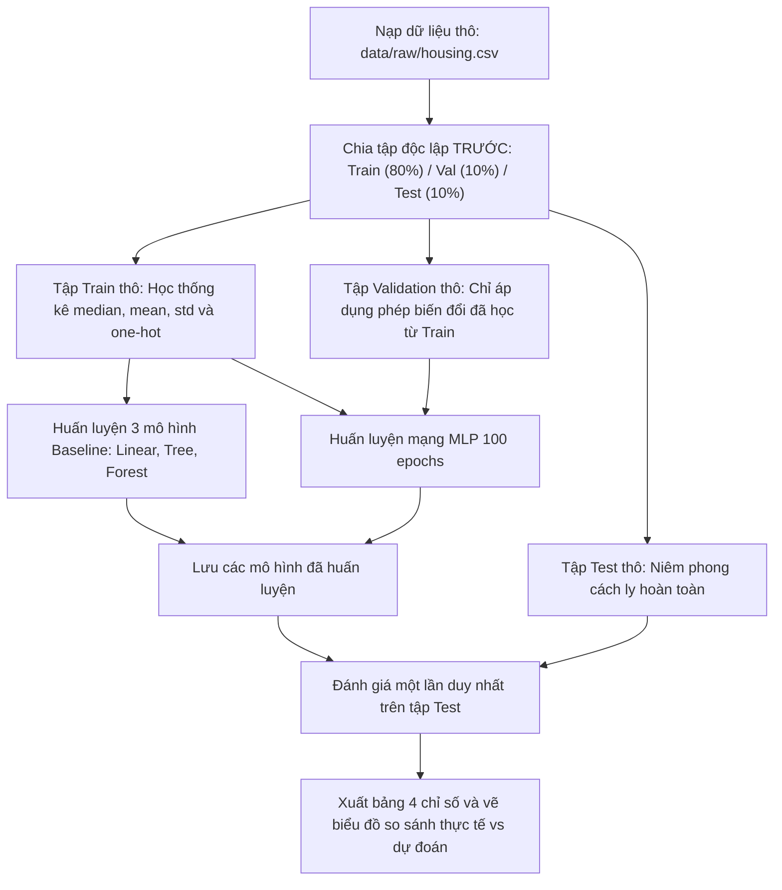

# Thiết kế bài lab dự đoán giá nhà theo 5W1H

> Cập nhật triển khai 16/11/2026: mỗi CLI run được lưu riêng tại `runs/<run_id>/`, gồm `data/processed/`, `results/`, `logs/` và `manifest.json`. Con trỏ `results/latest_run.json` chỉ cập nhật khi run hoàn tất. Các đường dẫn `results/...` và `data/processed/...` trong thiết kế ban đầu bên dưới được hiểu tương đối với thư mục run đối với CLI mới. Notebook giữ bảng/biểu đồ trong output `.ipynb`; cache bàn giao vẫn ở `notebooks/artifacts/`, tách hoàn toàn khỏi CLI.

Trong bài lab này, nhóm dự kiến thực hiện bài toán dự đoán giá nhà trung vị dựa trên tập dữ liệu California Housing. Mục tiêu chính là thực hành các bước cơ bản của một bài toán Machine Learning dạng hồi quy chuẩn mực: chia dữ liệu độc lập ngay từ đầu, tiền xử lý và chuẩn hóa trên tập Train, huấn luyện mô hình mạng nơ-ron nhiều tầng (MLP) cùng ba mô hình baseline truyền thống để so sánh đối chứng.

Tài liệu trình bày phương án thiết kế ban đầu trước khi triển khai, gồm phạm vi, cách tổ chức công việc, phương pháp thử nghiệm và tiêu chí đánh giá. Nhóm thống nhất các lựa chọn này trước khi bắt đầu thực hành và sẽ dựa vào kết quả đo đạc thực tế sau khi chạy xong để đưa ra nhận xét khách quan.

## 1. What

### Bài toán và phạm vi

Nhóm chọn bài toán **hồi quy có giám sát (Supervised Regression)**. Với các thông tin đặc trưng của một khu dân cư (vị trí địa lý, độ tuổi nhà, quy mô phòng, dân số, thu nhập trung vị), mô hình cần dự đoán một giá trị liên tục:

- Biến mục tiêu (`target`): `median_house_value` (giá trị nhà trung vị theo đơn vị USD).

Dữ liệu đầu vào là file CSV cục bộ tại đường dẫn `data/raw/housing.csv`. Nhóm kiểm tra nguồn dữ liệu, các cột đặc trưng và kiểu dữ liệu trước khi sử dụng. Vì biến mục tiêu biểu thị mức giá trung vị của toàn khu vực chứ không phải giá của từng căn nhà riêng lẻ, các đánh giá chỉ có ý nghĩa trong phạm vi phân phối của bộ dữ liệu này.

Phạm vi thực hiện gồm: chia tập dữ liệu độc lập ngay từ đầu theo tỷ lệ 80/10/10 (Train/Validation/Test), sau đó tiền xử lý chỉ học thống kê trên Train, tạo ma trận đặc trưng số, huấn luyện ba mô hình baseline (Linear Regression, Decision Tree, Random Forest), huấn luyện mạng MLP theo dõi qua tập Validation riêng, và cuối cùng đánh giá độc lập một lần duy nhất trên tập Test. Toàn bộ bài thực hành được thực hiện trên môi trường máy cá nhân phục vụ mục đích học tập.

### Dữ liệu đầu vào và kết quả đầu ra dự kiến

| Bước | Đầu vào | Đầu ra dự kiến |
| :--- | :--- | :--- |
| 1. Đọc và kiểm tra dữ liệu | File `data/raw/housing.csv` gồm 9 đặc trưng và cột giá nhà | Bảng dữ liệu thô đã xác thực đầy đủ các cột và kiểu dữ liệu |
| 2. Chia tập độc lập ngay từ đầu (Early Split) | Dữ liệu thô ban đầu | Ba tập dữ liệu thô độc lập: Train (80%), Validation (10%) và Test (10%) |
| 3. Tiền xử lý đặc trưng (chỉ fit trên Train) | Dữ liệu thô tập Train (Val và Test chỉ dùng phép biến đổi) | Ma trận đặc trưng số đã chuẩn hóa và bộ biến đổi đã fit |
| 4. Huấn luyện các mô hình baseline | Tập Train và Validation | Ba mô hình Linear Regression, Decision Tree và Random Forest đã huấn luyện |
| 5. Huấn luyện mạng MLP | Tập Train và tập Validation riêng | Mô hình MLP cùng lịch sử loss và MAE qua 100 epochs |
| 6. Đánh giá đối chứng độc lập | Bốn mô hình đã huấn luyện và tập Test | Bảng so sánh 4 chỉ số (MSE, RMSE, MAE, R²) và các biểu đồ phân tích |
| 7. Chạy thử nghiệm dự đoán | Một vài mẫu nhà từ tập Test | Mức giá dự đoán theo USD để quan sát sai số |
| 8. Lưu kết quả và mô hình | Mô hình và bộ biến đổi đã fit | CLI lưu mô hình trong `results/saved_models/`; notebook lưu artifact bàn giao dưới `notebooks/artifacts/` |

## 2. Why

Nhóm chọn bài toán dự đoán giá nhà vì đây là bài toán hồi quy kinh điển, giúp các thành viên trong nhóm nắm vững sự khác biệt giữa bài toán phân loại và bài toán dự đoán giá trị liên tục. Qua bài lab, nhóm muốn rèn luyện kỹ năng xử lý dữ liệu dạng bảng, hiểu cách mạng nơ-ron học quan hệ phi tuyến và so sánh hiệu quả thực tế giữa mạng MLP với các mô hình học máy truyền thống.

Nhóm bắt đầu từ các mô hình baseline đơn giản trước khi đi vào mạng nơ-ron để có mốc đối chiếu rõ ràng.

| Lựa chọn dự kiến | Lý do chọn | Hạn chế |
| :--- | :--- | :--- |
| Chia tập độc lập trước mọi bước tiền xử lý | Tuân thủ nguyên tắc chống rò rỉ dữ liệu (Data Leakage) từ Test sang Train | Cần quản lý chặt chẽ bộ tiền xử lý chỉ được học từ Train |
| Chuẩn hóa target chỉ từ train cho MLP; inverse-transform về USD | Hỗ trợ tối ưu và giữ MAE/RMSE dễ diễn giải | Phải lưu mean/std cùng checkpoint; objective chuẩn hóa khác MSE USD² được báo cáo |
| Huấn luyện Linear Regression làm baseline đầu tiên | Đơn giản, tính toán nhanh, hệ số trọng số giúp hiểu hướng tác động của đặc trưng | Chỉ mô hình hóa được quan hệ tuyến tính |
| Huấn luyện Decision Tree và Random Forest | Học được quan hệ phi tuyến dạng bậc thang và tương tác phức tạp giữa các đặc trưng | Decision Tree dễ bị quá khớp; Random Forest tốn tài nguyên tính toán hơn |
| Mạng PyTorch MLP (32 ReLU &rarr; 16 ReLU &rarr; 1 Linear) | Giữ cấu trúc của đề bài và áp dụng training loop theo bài giảng | Nhạy cảm với thang đo đặc trưng và tốc độ học |
| Tách riêng tập Validation độc lập khỏi tập Test | Có tập dữ liệu riêng để theo dõi quá trình học 100 epochs mà không làm lộ tập Test | Giảm bớt một phần lượng mẫu dùng cho huấn luyện |
| Theo dõi đồng thời MSE, RMSE, MAE và R² | Có cái nhìn đa chiều: MAE đo sai số trung bình, RMSE nhạy với sai số lớn, R² đo mức độ giải thích | Các chỉ số có thể cho thứ hạng mô hình khác nhau nếu có ngoại lai lớn |
| Lưu mô hình kèm theo đúng bộ tiền xử lý | Đảm bảo khi nạp lại để dự đoán dữ liệu mới thì các bước biến đổi hoàn toàn đồng nhất | Cần kiểm tra kỹ kích thước vector sau khi nạp |

Nhóm ưu tiên cách tiếp cận có thể giải thích được bản chất toán học của từng thuật toán. Mỗi mô hình được chọn đều có vai trò cụ thể trong bài thực hành để các thành viên cùng hiểu và trình bày được trong báo cáo.

## 3. Who

Bài lab phục vụ mục đích học tập môn học và hoàn thành bài tập thực hành theo yêu cầu giảng viên.

| Người tham gia | Vai trò trong bài lab |
| :--- | :--- |
| Nhóm sinh viên thực hiện | Phân công chuẩn bị dữ liệu, xây dựng pipeline tiền xử lý, huấn luyện mô hình, đánh giá và viết báo cáo |
| Giảng viên bộ môn | Theo dõi tiến độ, kiểm tra phương pháp thiết kế và đánh giá kết quả thực hành |
| Người thử nghiệm | Chạy thử chương trình với các mẫu dữ liệu và quan sát sai số dự đoán |

Nhóm phân chia công việc theo từng giai đoạn cụ thể tương ứng với các Issue và Milestone trên GitHub. Các thành viên cùng dùng chung quy ước chia tập, seed ngẫu nhiên và bộ chỉ số đánh giá để đảm bảo kết quả có thể ghép nối thành một quy trình thống nhất.

## 4. When

Nhóm dự kiến thực hiện bài lab theo từng bước tuần tự, hoàn thành và nghiệm thu phần dữ liệu trước khi huấn luyện mô hình, và chỉ mở tập Test khi toàn bộ việc huấn luyện đã xong.

| Bước | Nội dung công việc | Kết quả cần đạt |
| :---: | :--- | :--- |
| 1 | Xác định phạm vi bài toán, kiểm tra dữ liệu thô và thống nhất các chỉ số đánh giá | Tài liệu thiết kế tổng quan và thiết kế thuật toán |
| 2 | Chia dữ liệu thành ba tập Train, Validation, Test theo tỷ lệ 80/10/10 với seed cố định | Ba tập dữ liệu thô độc lập, tập Test được niêm phong |
| 3 | Xây dựng bộ tiền xử lý (điền khuyết, mã hóa, chuẩn hóa) chỉ học trên tập Train | Bộ tiền xử lý đã fit và ma trận đặc trưng số |
| 4 | Huấn luyện ba mô hình baseline (Linear Regression, Decision Tree, Random Forest) | Ba mô hình baseline hoàn chỉnh làm mốc đối chứng |
| 5 | Xây dựng và huấn luyện mạng MLP 100 epochs, theo dõi đường học trên tập Validation | Mô hình MLP, lịch sử loss và đồ thị quá trình học |
| 6 | Đánh giá cả bốn mô hình trên tập Test độc lập, lập bảng so sánh và phân tích sai số | Bảng 4 chỉ số, các biểu đồ trực quan hóa và nhận xét |
| 7 | Tích hợp toàn tuyến qua chương trình điều phối chính và hoàn tất báo cáo | Toàn bộ pipeline chạy thông suốt và tài liệu tổng kết |

Nếu kết quả đo đạc trên tập Test cho thấy mô hình chưa tốt, nhóm sẽ ghi nhận trung thực hạn chế đó trong phần thảo luận thay vì dùng kết quả Test để chỉnh sửa lại tham số mô hình.

## 5. Where

Bài lab được thực hiện trên môi trường máy tính cá nhân sử dụng Python. Các thành viên sử dụng chung cấu hình môi trường và seed ngẫu nhiên để đảm bảo tính tái lập của kết quả.

Không gian làm việc của dự án được tổ chức như sau:

| Thư mục / Vị trí | Trách nhiệm chính |
| :--- | :--- |
| `src/data/` | Đọc dữ liệu, chia tập Train/Val/Test và các bước tiền xử lý |
| `src/models/` | Xây dựng các mô hình baseline, mạng MLP và lưu trữ mô hình |
| `src/evaluation/` | Tính toán 4 chỉ số đo lường và vẽ các biểu đồ đánh giá |
| `data/raw/`, `data/processed/` | Lưu trữ file CSV gốc và các tập dữ liệu thô sau khi chia |
| `docs/` | Tài liệu thiết kế bài lab và tài liệu giải thích thuật toán |
| `notebooks/` | Các notebook thực hành tuần tự; bảng kết quả, biểu đồ và nhận xét hiển thị trực tiếp trong notebook |
| `notebooks/artifacts/` | Raw splits, preprocessor, models và training history phục vụ bàn giao giữa các notebook |
| `results/` | Biểu đồ, bảng tổng hợp chỉ số và mô hình do CLI `main.py` xuất ra |

Notebook giữ kết quả phân tích trong các ô output của chính notebook, không xuất bảng hoặc biểu đồ vào `results/` ở thư mục gốc. Artifact dưới `notebooks/artifacts/` chỉ phục vụ tái sử dụng dữ liệu và mô hình giữa các giai đoạn. CLI vẫn sử dụng các đường dẫn đầu ra ở thư mục gốc theo cấu hình dự án.

## 6. How

### 6.1. Luồng dữ liệu dự kiến



### 6.2. Dữ liệu và nguyên tắc chống rò rỉ (Chia tập trước, Tiền xử lý sau)

1. **Nguyên tắc chia tập trước:** Dữ liệu thô được chia ngay từ bước đầu tiên thành Train (80%), Validation (10%) và Test (10%) với `seed = 42`. Tập Test được giữ nguyên vẹn và niêm phong cách ly để phục vụ bước đánh giá cuối cùng.
2. **Học thống kê chỉ trên Train:** Toàn bộ giá trị trung vị để điền khuyết (`total_bedrooms`), danh sách nhóm phân loại để mã hóa (`ocean_proximity`), giá trị trung bình (`mean`) và độ lệch chuẩn (`std`) để chuẩn hóa Z-score CHỈ ĐƯỢC TÍNH TOÁN TRÊN TẬP TRAIN.
3. **Validation và Test chỉ áp dụng phép biến đổi:** Hai tập này chỉ đi qua các bước biến đổi bằng tham số đã học từ Train, tuyệt đối không tính lại trung bình hay độ lệch chuẩn trên dữ liệu của chúng.
4. **Phân biệt objective và đơn vị báo cáo:** Dữ liệu gốc và baseline dùng USD. MLP học target chuẩn hóa bằng thống kê chỉ từ train; prediction được inverse-transform về USD trước khi tính metrics và vẽ biểu đồ.

### 6.3. Chiến lược mô hình

Nhóm dự kiến xây dựng 4 mô hình trên cùng một bộ dữ liệu đầu vào đã tiền xử lý:

- **Baseline 1 — Linear Regression:** Mô hình hồi quy tuyến tính cổ điển, tính toán nhanh và cung cấp mốc tham chiếu cơ bản nhất.
- **Baseline 2 — Decision Tree Regression:** Cây quyết định có giới hạn độ sâu để nắm bắt quan hệ phi tuyến dạng phân vùng không gian.
- **Baseline 3 — Random Forest Regression:** Rừng gồm 100 cây, bootstrap mẫu và `max_features=1.0`; mỗi nút xét toàn bộ đặc trưng, không thực hiện feature subsampling trong cấu hình này.
- **Mô hình trọng tâm — Multilayer Perceptron (MLP):** Mạng nơ-ron truyền thẳng 2 lớp ẩn (32 ReLU &rarr; 16 ReLU &rarr; 1 Linear), tối ưu bằng thuật toán Adam với hàm mất mát MSE và theo dõi MAE qua 100 epochs.

### 6.4. Metrics và quy tắc đánh giá

Để đánh giá toàn diện khả năng dự đoán giá nhà, nhóm theo dõi 4 chỉ số trên cùng tập Test:

- **Mean Absolute Error (MAE):** Sai số tuyệt đối trung bình (đơn vị USD), phản ánh mức chênh lệch trung bình giữa giá dự đoán và giá thật.
- **Root Mean Squared Error (RMSE):** Căn bậc hai sai số bình phương trung bình (đơn vị USD), phạt nặng hơn đối với các mẫu có sai số lớn.
- **Mean Squared Error (MSE):** Sai số bình phương trung bình (đơn vị USD&sup2;), là hàm mất mát tối ưu trực tiếp của MLP và Linear Regression.
- **R-squared ($R^2$ Score):** Hệ số xác định (không đơn vị), đo tỷ lệ phương sai của giá nhà được mô hình giải thích được (càng gần 1 càng tốt).

Với target hằng số và ít nhất hai mẫu, áp dụng quy ước `r2_score(force_finite=True)` của Scikit-learn: dự đoán hoàn hảo nhận R² = 1, các trường hợp còn lại nhận R² = 0. Với chỉ một mẫu, R² không xác định; không dùng mẫu minh họa đơn lẻ để xếp hạng mô hình.

**Quy tắc nhận xét:** Nhóm sẽ dựa vào MAE và RMSE để đánh giá mức độ sai lệch theo tiền tệ thực tế, kết hợp $R^2$ để đánh giá khả năng mô hình hóa tổng thể. Nếu mô hình cây cho kết quả tốt hơn mạng MLP, nhóm sẽ phân tích nguyên nhân dựa trên đặc thù của dữ liệu dạng bảng thay vì thiên vị cho mạng nơ-ron.

### 6.5. Kế hoạch kiểm tra tính đúng đắn

- **Dữ liệu:** Kiểm tra số lượng dòng và cột được bảo toàn sau khi chia tập; kiểm tra không có mẫu nào trùng lặp giữa các tập; kiểm tra cùng một seed luôn cho kết quả chia giống nhau.
- **Bộ tiền xử lý:** Kiểm tra ma trận sau tiền xử lý không còn giá trị NaN; kiểm tra số cột cố định khi áp dụng cho dữ liệu mới.
- **Mô hình:** Kiểm tra dự đoán và loss hữu hạn; quan sát xu hướng loss cùng khoảng cách Train/Validation để đánh giá hội tụ. Loss có thể dao động giữa các epochs, không yêu cầu giảm đơn điệu và không tự thay cấu hình dựa trên Test.
- **Lưu và nạp:** Kiểm tra dự đoán trước/sau khi lưu và nạp khớp nhau trong sai số số học cho phép trên cùng đầu vào và cùng bộ tiền xử lý.

### 6.6. Các trường hợp dễ gặp lỗi và giới hạn

Nhóm lưu ý một số đặc điểm đặc thù của bộ dữ liệu California Housing có thể ảnh hưởng đến kết quả:

- **Hiện tượng trần giá (Target Capping):** Có 965 dòng dữ liệu mang giá trị đúng 500.001 USD do bị làm tròn trần trong quá trình thu thập gốc. Mô hình có thể dự đoán dưới mức này ở các căn nhà thực tế có giá cao hơn. Nhóm giữ nguyên các mẫu này và sẽ phân tích hiện tượng này trong phần nhận xét.
- **Nhóm phân loại rất hiếm:** Nhóm vị trí `ISLAND` chỉ có 5 dòng trong toàn bộ dữ liệu. Khi chia tập ngẫu nhiên, tập Train có thể chứa rất ít hoặc không chứa nhóm này. Bộ mã hóa cần có cơ chế xử lý giá trị chưa thấy để tránh phát sinh lỗi.
- **Ngoại suy giá trị âm:** Mạng MLP và Linear Regression có thể dự đoán ra giá trị âm đối với các căn nhà ở vùng đặc trưng cực đoan nếu không được kiểm soát. Nhóm sẽ ghi nhận các trường hợp này trong phần phân tích phần dư.

## 7. Cấu trúc dự án dự kiến

Nhóm tổ chức cấu trúc thư mục rõ ràng theo từng phân hệ để các thành viên dễ phân công và quản lý mã nguồn:

| Tiêu chí | Cách áp dụng dự kiến | Mục đích |
| :--- | :--- | :--- |
| Chia theo trách nhiệm | Tách biệt các thư mục dữ liệu, mô hình, đánh giá | Dễ phân công và kiểm tra chéo công việc |
| Phân biệt tài liệu và kết quả | Tài liệu trong `docs/`; CLI xuất `results/`; notebook chứa bảng và biểu đồ trong output của notebook | Tránh nhầm lẫn giữa kế hoạch dự kiến và kết quả thực tế |
| Bảo vệ dữ liệu gốc | Đặt file CSV ban đầu trong `data/raw/` và không sửa trực tiếp | Luôn có dữ liệu gốc để đối chiếu và chạy lại |
| Nhất quán trong quy ước | Tên các tệp và thư mục sử dụng chuẩn `snake_case` | Dễ tìm kiếm và gọi hàm giữa các module |

```text
Lab_4 Predicting House Prices/
├── README.md                         # Giới thiệu dự án và hướng dẫn thực thi
├── requirements.txt                  # Danh sách thư viện sử dụng trong bài lab
├── main.py                           # Chương trình điều phối toàn bộ pipeline
├── data/
│   ├── raw/                          # Dữ liệu gốc California Housing (housing.csv)
│   └── processed/                    # Dữ liệu thô sau khi chia (train.csv, val.csv, test.csv)
├── docs/
│   ├── design.md                     # Tài liệu thiết kế tổng quan bài lab theo 5W1H
│   ├── Practice exercise 4.pdf       # Đề bài thực hành gốc
│   └── algorithims/                  # Thư mục thiết kế chi tiết các thuật toán
│       ├── README.md                 # Giới thiệu các thuật toán trong bài lab
│       ├── mlp_regression.md         # Thiết kế mạng nơ-ron Multilayer Perceptron
│       ├── linear_regression.md      # Thiết kế mô hình hồi quy tuyến tính
│       ├── decision_tree.md          # Thiết kế cây quyết định hồi quy
│       └── random_forest.md          # Thiết kế rừng ngẫu nhiên hồi quy
├── notebooks/
│   ├── artifacts/                    # Artifact phụ trợ bàn giao giữa các notebook
│   ├── README.md                     # Hướng dẫn thứ tự chạy các notebook
│   ├── 01_eda_and_preprocessing.ipynb # Khám phá dữ liệu và tiền xử lý
│   ├── 02_mlp_model_training.ipynb   # Huấn luyện baseline và mạng MLP
│   └── 03_baseline_and_comparison.ipynb # Đánh giá, trực quan hóa và so sánh mô hình
├── src/
│   ├── config.py                     # Quản lý đường dẫn, siêu tham số và seed cố định
│   ├── data/
│   │   ├── loader.py                 # Nạp và kiểm tra dữ liệu thô
│   │   └── preprocessing.py          # Chia tập và biến đổi đặc trưng
│   ├── features/
│   │   └── feature_engineering.py    # Các hàm tạo đặc trưng bổ sung (tùy chọn)
│   ├── models/
│   │   ├── baseline_models.py        # Định nghĩa 3 mô hình học máy truyền thống
│   │   ├── mlp_model.py              # Xây dựng kiến trúc mạng PyTorch nn.Module MLP
│   │   └── persistence.py            # Lưu và nạp các mô hình đã huấn luyện
│   ├── evaluation/
│   │   ├── metrics.py                # Tính toán MSE, RMSE, MAE, R2
│   │   └── visualization.py          # Vẽ biểu đồ phân tán, đường học và biểu đồ cột
│   └── utils/
│       └── logger.py                 # Ghi nhận nhật ký chạy chương trình
├── tests/                            # Các bài kiểm thử đơn vị và tích hợp
└── results/
    ├── figures/                      # Lưu trữ các biểu đồ xuất ra
    ├── metrics/                      # Lưu trữ bảng tổng hợp chỉ số
    └── saved_models/                 # Lưu trữ bộ tiền xử lý và file mô hình
```


