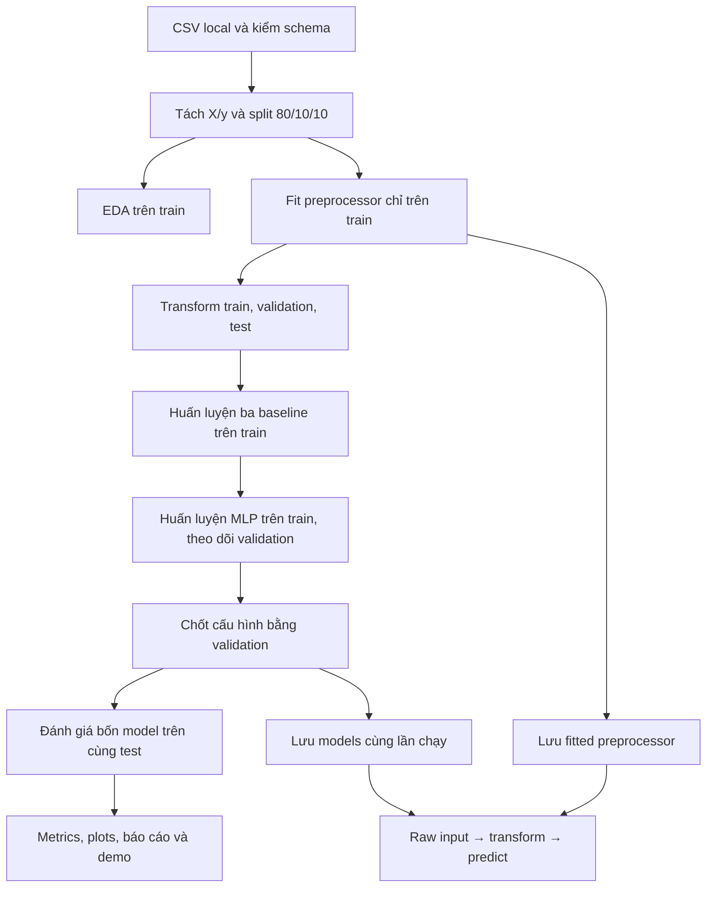

# Design — Lab 4: Predicting House Prices theo 5W1H

## 1. Căn cứ và đối chiếu yêu cầu đề

Nguồn yêu cầu:

- [Practice exercise 4.pdf](<Practice exercise 4.pdf>): đề gốc, hai trang, Tasks 1–6.
- Dữ liệu đầu vào: `data/raw/housing.csv`; các thống kê dữ liệu được kiểm tra trực tiếp từ CSV.

| Yêu cầu | Nội dung đề                                                              | Thiết kế dự án / bằng chứng cần bàn giao                                                                        |
| --------- | --------------------------------------------------------------------------- | ----------------------------------------------------------------------------------------------------------------------- |
| Task 1    | Import thư viện phục vụ dữ liệu, scaling, MLP và biểu đồ          | Khai báo dependency trong `requirements.txt`; notebook gọi logic dùng chung trong `src/`                         |
| Task 2    | Boston Housing; tách X/y, StandardScaler, train/test                       | California CSV local; split trước preprocessing; bổ sung imputation và categorical encoding phù hợp schema        |
| Task 3    | Sequential, Dense, ReLU hidden, linear output, Adam và MSE                 | MLP `32 ReLU → 16 ReLU → 1 linear`; `input_dim` lấy từ dữ liệu sau transform                                  |
| Task 4    | Train, theo dõi MSE và MAE                                                | 100 epochs, batch size 32; history gồm loss/val_loss/mae/val_mae; validation riêng                                    |
| Task 5    | Evaluate test; dự đoán và so sánh actual/predicted                     | Metrics trên test, scatter plot, phân tích residuals và demo suy luận                                              |
| Task 6    | Linear Regression, Decision Tree, Random Forest; MSE/R²; so sánh với MLP | Ba baseline chạy trước MLP, dùng cùng split/preprocessor; bảng bốn mô hình và nhận xét dựa kết quả thật |

### Khác biệt cần ghi rõ khi báo cáo

| Nội dung           | PDF                                                                                       | Quyết định thiết kế                                                           |
| ------------------- | ----------------------------------------------------------------------------------------- | ---------------------------------------------------------------------------------- |
| Dataset             | Phần giới thiệu nêu Boston như ví dụ; Task 2 và code mẫu dùng Boston            | `data/raw/housing.csv`, California Housing; không tự tải hoặc đổi dataset  |
| Split               | Code mẫu train/test 80/20, seed 42                                                       | Train/validation/test 80/10/10, seed 42                                            |
| Validation          | Code mẫu dùng test làm validation                                                      | Validation độc lập; test dành cho đánh giá cuối                            |
| Metrics             | MSE/MAE trong phần yêu cầu, MSE/R² trong Task 6; code compile chỉ khai báo MSE loss | MSE, RMSE, MAE, R²; khai báo MAE khi compile                                     |
| Learning rate       | Code mẫu chỉ ghi optimizer Adam                                                         | `0.001` theo cấu hình dự án, không phải con số ghi tường minh trong PDF |
| Cấu hình baseline | PDF không ấn định depth hoặc số cây                                                | Decision Tree `max_depth=5`, Random Forest `n_estimators=100`                  |

California và tỷ lệ 8:1:1 là quyết định thiết kế đã được người dùng duyệt, không trình bày như yêu cầu nguyên văn của đề. Design không tự đặt ngưỡng MAE/R² để nghiệm thu vì đề chưa quy định ngưỡng đó.

## 2. What — Xây dựng cái gì?

Xây dựng pipeline supervised learning cho bài toán **regression**, dự đoán `median_house_value` từ chín đặc trưng California Housing. Target là giá trị nhà trung vị của khu vực theo USD, không phải giá giao dịch của một căn nhà riêng lẻ.

### Đầu vào

| Nhóm               | Các cột                                                                                                                                   |
| ------------------- | ------------------------------------------------------------------------------------------------------------------------------------------- |
| Numeric, 8 cột     | `longitude`, `latitude`, `housing_median_age`, `total_rooms`, `total_bedrooms`, `population`, `households`, `median_income` |
| Categorical, 1 cột | `ocean_proximity`                                                                                                                         |
| Target              | `median_house_value`                                                                                                                      |

Thống kê kiểm tra trực tiếp từ `data/raw/housing.csv`: CSV có 20.640 hàng; `total_bedrooms` thiếu 207 giá trị; `ocean_proximity` có 5 nhóm; 965 hàng có target ở mức lớn nhất 500001 USD; nhóm `ISLAND` có 5 hàng. Kiểm tra lại các thống kê khi tiếp nhận dữ liệu.

### Đầu ra

- Ba raw split CSV: train, validation, test, mỗi file có target.
- Fitted preprocessor, ba baseline đã fit và MLP đã train.
- Bảng MSE/RMSE/MAE/R² của bốn mô hình trên cùng test.
- Learning curves, actual-vs-predicted và biểu đồ so sánh mô hình.
- Notebook diễn giải quy trình, kết quả thực nghiệm và giới hạn; demo ba mẫu test qua chuỗi preprocessing → predict.

Phần cốt lõi giữ target nguyên USD, feature engineering tắt mặc định. Triển khai web/API, cloud serving, stacking và các boosting frameworks không thuộc phạm vi bài này.

## 3. Why — Vì sao thiết kế như vậy?

Mục tiêu học tập là hiểu đầy đủ luồng dữ liệu → mô hình → đánh giá, kiểm chứng MLP bằng các mô hình regression đối chứng và giải thích kết quả. MLP là nội dung bắt buộc của bài, không có giả định rằng MLP sẽ vượt baseline.

| Quyết định                        | Lý do                                                                            | Trade-off                                                                       |
| ------------------------------------ | --------------------------------------------------------------------------------- | ------------------------------------------------------------------------------- |
| Linear Regression chạy đầu tiên  | Mô hình dễ giải thích, kiểm nhanh toàn tuyến dữ liệu/metrics            | Có thể bỏ sót quan hệ phi tuyến                                           |
| Validation riêng                    | Chọn cấu hình mà vẫn giữ test độc lập                                    | Train dùng 80%, test còn 10%; kết quả phụ thuộc split                     |
| Fit preprocessing chỉ trên train   | Ngăn thông tin validation/test đi vào thống kê học                         | Phải xử lý category chưa thấy và kiểm schema khi suy luận               |
| Một preprocessor cho bốn mô hình | So sánh trên cùng đầu vào và giảm khác biệt pipeline                    | Scaling không cần thiết cho tree nhưng vẫn được dùng để thống nhất |
| Giữ target USD                      | Diễn giải MAE/RMSE trực tiếp, tránh nhầm đơn vị                          | MLP có thể hội tụ chậm; chỉ đánh giá được qua thực nghiệm         |
| Phân chia module theo trách nhiệm | Tách xử lý dữ liệu, mô hình và đánh giá; notebooks tái sử dụng code | Phải giữ nhất quán hợp đồng giữa notebook và CLI                       |

Nếu baseline tốt hơn, báo cáo đúng kết quả và phân tích nguyên nhân. Thay đổi target transform, kiến trúc hoặc thêm feature engineering là thí nghiệm riêng sau baseline, cần kế hoạch validation và phê duyệt trước khi mở rộng scope.

## 4. Who — Phục vụ ai, ai phụ trách?

Người sử dụng trực tiếp là nhóm sinh viên triển khai và giảng viên đọc notebook, code, kết quả để đánh giá bài thực hành.

| Vai trò triển khai | Trách nhiệm                                                                         | Bàn giao                                                                               |
| -------------------- | ------------------------------------------------------------------------------------- | --------------------------------------------------------------------------------------- |
| Nhóm dữ liệu      | Config, local loader, split, preprocessing; feature engineering optional; notebook 01 | Raw splits, fitted preprocessor và kiểm chứng dữ liệu                              |
| Nhóm mô hình      | Baselines, MLP, persistence; notebook 02                                              | Models cùng preprocessor tương ứng, history và kiểm chứng save/load              |
| Nhóm đánh giá    | Metrics, visualization, logging, orchestration; notebook 03                           | Bảng so sánh, biểu đồ, phân tích kết quả và demo                              |
| Cả nhóm            | Tích hợp và `tests/test_pipeline.py`                                             | Chuỗi từ raw input tới dự đoán nhất quán, tài liệu phản ánh kết quả thật |

Notebook dùng hàm trong `src/`, tránh tạo implementation thứ hai. Người nhận artifact phải biết artifact đó thuộc cùng lần chia dữ liệu và huấn luyện nào; không ghép model với preprocessor từ lần chạy khác.

## 5. Where — Chạy ở đâu, dữ liệu nằm ở đâu?

Pipeline chạy local bằng Python. Hai cách sử dụng dự kiến là `main.py` điều phối toàn tuyến và notebooks chạy theo thứ tự 01 → 02 → 03. Dataset duy nhất là `data/raw/housing.csv`; loader phải báo lỗi khi thiếu file hoặc schema sai.

`src/config.py` quản lý đường dẫn từ root dự án. Chỉ entrypoint tạo thư mục output khi chạy pipeline; import config không tự ghi đĩa. Môi trường phát triển cần hỗ trợ notebook và kiểm thử; thống nhất dependency và phiên bản trước khi triển khai.

### Target structure

Cấu trúc thư mục được tổ chức theo trách nhiệm từng module. Dấu `[generated]` chỉ artifact được sinh khi chạy pipeline.

```text
Lab_4 Predicting House Prices/
├── main.py                             # Chạy lần lượt các bước và minh họa dự đoán
├── requirements.txt                    # Danh sách thư viện cần cài đặt
├── README.md                           # Giới thiệu bài toán và hướng dẫn chạy
├── AGENTS.md                           # Quy tắc làm việc trong dự án
├── docs/
│   ├── design.md                       # Thiết kế theo 5W1H và cấu trúc thư mục
│   └── Practice exercise 4.pdf          # Đề bài thực hành
├── data/
│   ├── raw/housing.csv                 # Dữ liệu California Housing đầu vào
│   └── processed/
│       ├── train.csv                   # [generated] Dữ liệu train và target, chưa tiền xử lý
│       ├── val.csv                     # [generated] Dữ liệu validation và target, chưa tiền xử lý
│       └── test.csv                    # [generated] Dữ liệu test và target, chưa tiền xử lý
├── src/
│   ├── __init__.py                     # Khai báo package mã nguồn
│   ├── config.py                       # Quản lý đường dẫn, cột dữ liệu và tham số mô hình
│   ├── data/
│   │   ├── __init__.py                 # Khai báo package xử lý dữ liệu
│   │   ├── loader.py                   # Đọc CSV, kiểm tra các cột và thống kê dữ liệu
│   │   └── preprocessing.py            # Chia tập, điền giá trị thiếu, mã hóa, chuẩn hóa và lưu CSV
│   ├── features/
│   │   ├── __init__.py                 # Khai báo package tạo đặc trưng
│   │   └── feature_engineering.py      # Tạo đặc trưng bổ sung; chưa bật trong quy trình chính
│   ├── models/
│   │   ├── __init__.py                 # Khai báo package mô hình
│   │   ├── baseline_models.py          # Huấn luyện và dự đoán bằng Linear Regression, Decision Tree, Random Forest
│   │   ├── mlp_model.py                # Xây dựng, huấn luyện, đánh giá và dự đoán bằng MLP
│   │   └── persistence.py              # Lưu và nạp lại các mô hình cùng bộ tiền xử lý
│   ├── evaluation/
│   │   ├── __init__.py                 # Khai báo package đánh giá
│   │   ├── metrics.py                  # Tính MSE, RMSE, MAE, R² và tổng hợp bảng so sánh
│   │   └── visualization.py            # Vẽ đường học, giá thực tế/dự đoán, phần dư và so sánh mô hình
│   └── utils/
│       ├── __init__.py                 # Khai báo package tiện ích dùng chung
│       └── logger.py                   # Thiết lập log và ghi tiến trình từng bước
├── notebooks/
│   ├── README.md                       # Hướng dẫn chạy các notebook theo thứ tự
│   ├── 01_eda_and_preprocessing.ipynb   # Khám phá dữ liệu train, chia tập và tiền xử lý
│   ├── 02_mlp_model_training.ipynb      # Huấn luyện baseline trước MLP, theo dõi và lưu mô hình
│   └── 03_baseline_and_comparison.ipynb # Nạp mô hình, đánh giá test và phân tích kết quả
├── tests/
│   ├── __init__.py                     # Khai báo package kiểm thử
│   ├── test_data.py                    # Kiểm tra đọc dữ liệu, chia tập và tiền xử lý
│   ├── test_features.py                # Kiểm tra cách tạo đặc trưng bổ sung
│   ├── test_models.py                  # Kiểm tra baseline, MLP và kích thước dự đoán
│   ├── test_evaluation.py              # Kiểm tra cách tính các chỉ số đánh giá
│   └── test_pipeline.py                # Kiểm tra toàn bộ quy trình và dự đoán sau khi lưu/nạp
├── results/
│   ├── saved_models/
│   │   ├── preprocessor.joblib         # [generated] Bộ tiền xử lý đã fit trên train
│   │   ├── baseline_models.joblib      # [generated] Ba mô hình baseline đã huấn luyện
│   │   └── mlp_house_price_model.keras # [generated] Mô hình MLP đã huấn luyện
│   ├── metrics/
│   │   └── model_performance_summary.csv # [generated] Bảng chỉ số của bốn mô hình trên test
│   └── figures/                        # [generated] Biểu đồ huấn luyện và đánh giá
└── logs/
    └── training.log                    # [generated] Nhật ký chạy và thông tin lỗi
```

Hướng phụ thuộc: `main.py`/notebooks gọi các module dữ liệu, model và evaluation; các module dùng config chung. Loader không huấn luyện model; evaluation không fit preprocessing; persistence không tự thay đổi split.

## 6. When — Triển khai theo thứ tự nào?

Triển khai theo các giai đoạn dưới đây, với điều kiện hoàn thành trước khi chuyển bước.

| Bước | Công việc                                                   | Điều kiện chuyển bước                                             |
| ------ | ------------------------------------------------------------- | ----------------------------------------------------------------------- |
| 1      | Chốt schema, metrics, môi trường và hợp đồng artifact | Các nhóm thống nhất đầu vào/đầu ra và cách chạy             |
| 2      | Loader, raw split 80/10/10, EDA train                         | Schema hợp lệ, X/y thẳng hàng, split tái lập và không giao nhau |
| 3      | Fit/transform preprocessing, lưu raw splits và preprocessor | Chỉ học train; NaN/category mới/thứ tự cột được kiểm          |
| 4      | Linear Regression → Decision Tree → Random Forest           | Baselines fit/predict đúng shape trên cùng dữ liệu                |
| 5      | MLP theo cấu hình đề và validation riêng                | Có history thật, dự đoán hữu hạn, kiểm tra overfitting          |
| 6      | Persistence và chốt cấu hình bằng validation             | Save/load toàn chuỗi cho dự đoán nhất quán                       |
| 7      | Đánh giá test cuối cùng và phân tích                  | Bảng bốn model, plots, nhận xét từ kết quả thực tế             |
| 8      | Hoàn thiện notebooks và báo cáo                          | Chạy tuần tự, nêu rõ khác biệt với PDF và giới hạn           |

Tên notebook 03 có chữ baseline nhưng việc huấn luyện baseline diễn ra trước MLP trong notebook 02; notebook 03 nạp models để đánh giá cuối.

## 7. How — Xử lý dữ liệu, huấn luyện và đánh giá mô hình như thế nào?

### 7.1. Luồng tổng thể



Transform test bằng thống kê train không phải fit; không dùng kết quả test để chọn feature, thay hyperparameter hoặc quyết định dừng train.

### 7.2. Dữ liệu và preprocessing

| Hàm / đối tượng                    | Input                            | Output và điều kiện                                                                  |
| --------------------------------------- | -------------------------------- | ---------------------------------------------------------------------------------------- |
| `load_housing_data(filepath=None)`    | CSV local theo schema            | `(df, target_col)`; giữ missing features; target phải hợp lệ, không impute target |
| `split_data_8_1_1(X, y, ...)`         | DataFrame/Series thô            | `X_train, X_val, X_test, y_train, y_val, y_test`; giữ index và alignment             |
| `fit_preprocessor(X_train)`           | Chín raw feature, không target | Fitted `ColumnTransformer`; reject cột train thiếu hoàn toàn                       |
| `transform_features(preprocessor, X)` | Raw features đúng schema       | Dense ndarray `(N, D)` hữu hạn; giữ số dòng; không refit                         |
| `save_processed_splits(...)`          | Sáu tập thô                   | Ba CSV có feature thô + target, giữ NaN, `index=False`                              |

Split dùng seed 42: train/temp 80/20 rồi chia temp thành validation/test 50/50. Với 20.640 mẫu đầu vào, số hàng dự kiến là 16.512/2.064/2.064. Nếu bật stratify, dùng `qcut` theo phân vị target, `duplicates='drop'`, kiểm số mẫu mỗi bin và tính khả thi trước split. Không khả thi phải báo lỗi để chọn giảm bins hoặc `stratify=False`, không fallback ngầm. Kiểm ba tập không giao nhau trước khi bỏ index lúc ghi CSV.

Preprocessor có hai nhánh:

- Numeric: `SimpleImputer(strategy='median') → StandardScaler`.
- Categorical: `SimpleImputer(strategy='most_frequent') → OneHotEncoder(handle_unknown='ignore', sparse_output=False, drop=None)`.

Chọn cột theo tên và thứ tự trong config. Raw input được phép đảo thứ tự cột nhưng thiếu/dư cột phải báo lỗi. Category chưa thấy trở thành vector toàn 0 trong nhánh one-hot, không làm đổi `D`. Không dùng `get_dummies` độc lập cho từng tập. Numeric không hằng sau scaling có std xấp xỉ 1; không áp điều kiện này cho cột hằng hoặc one-hot.

EDA phục vụ chọn feature dùng train sau split. Nếu bật `HousingFeatureEngineer` trong thí nghiệm sau, phải đưa vào preprocessing artifact chung, kiểm chia cho 0/miền log và dùng validation để đánh giá; không học thống kê từ test.

### 7.3. Models và lý do lựa chọn

| Model                   | Cấu hình cốt lõi                    | Khả năng / giới hạn cần đánh giá                                                                                                                             |
| ----------------------- | --------------------------------------- | -------------------------------------------------------------------------------------------------------------------------------------------------------------------- |
| Linear Regression       | `fit_intercept=True`                  | Dễ giải thích; có thể underfit phi tuyến. One-hot đầy đủ cùng intercept có thể làm hệ số không duy nhất, cần thận trọng khi diễn giải hệ số |
| Decision Tree Regressor | `max_depth=5`, seed 42                | Học ngưỡng và tương tác; cây nông có thể underfit, cây sâu có thể overfit                                                                             |
| Random Forest Regressor | `n_estimators=100`, seed 42           | Tổng hợp cây, học phi tuyến; tốn tài nguyên hơn, khó giải thích trực tiếp hơn một cây                                                               |
| MLP Keras               | `D → 32 ReLU → 16 ReLU → 1 linear` | Học quan hệ phi tuyến; nhạy scaling, initialization, thang target và overfitting                                                                                |

MLP dùng Adam learning rate 0.001, MSE loss, MAE metric, 100 epochs và batch size 32. `D = X_train_transformed.shape[1]`, không hardcode số chiều. `train_mlp_model` nhận validation riêng và trả model/history; `predict_mlp` trả vector `(N,)`, kể cả khi `N=1`.

Bốn model dùng cùng train và preprocessor. Theo dõi train/validation để phân biệt underfitting, overfitting hoặc không hội tụ. Seed hỗ trợ tái lập split và các thành phần có random state; không mặc nhiên đảm bảo TensorFlow cho kết quả bit-for-bit trên mọi phần cứng. Ghi lại cấu hình/môi trường khi báo cáo thực nghiệm.

### 7.4. Metrics và nguyên tắc đánh giá

Với sai số `e_i = y_i - y_pred_i` và `N` mẫu:

| Metric | Công thức                                 | Đơn vị / diễn giải                                     |
| ------ | ------------------------------------------- | ----------------------------------------------------------- |
| MSE    | `sum(e_i²) / N`                          | USD²; thấp hơn tốt hơn, phạt mạnh sai số lớn       |
| RMSE   | `sqrt(MSE)`                               | USD; thấp hơn tốt hơn                                   |
| MAE    | `sum(abs(e_i)) / N`                       | USD; sai số tuyệt đối trung bình, thấp hơn tốt hơn |
| R²    | `1 - sum(e_i²) / sum((y_i - mean(y))²)` | Không đơn vị; cao hơn tốt hơn, có thể âm          |

Không dùng accuracy cho regression. Metrics nhận vector cùng số mẫu, không rỗng, hữu hạn; tránh broadcasting do trộn shape `(N,)` và `(N,1)`. Trường hợp target hằng hoặc quá ít mẫu cần thống nhất quy ước xử lý R² và kiểm thử riêng trước khi sử dụng metric.

Trong validation, báo cáo cả bốn metrics và mô tả trade-off nếu thứ hạng MAE khác MSE. Nếu tiến hành tuning, chốt metric ưu tiên trước thí nghiệm. Sau khi chốt cấu hình, đánh giá cả bốn model trên cùng test ở giai đoạn báo cáo cuối; không tiếp tục chọn model bằng test.

Phân tích cần có actual-vs-predicted, learning curves, residuals, sai số vùng giá cao và các nhóm có đủ mẫu. Không dùng vài quan sát của nhóm hiếm để kết luận hiệu năng ổn định.

### 7.5. Artifact và suy luận

| Artifact                                                | Hợp đồng                                                                               |
| ------------------------------------------------------- | ----------------------------------------------------------------------------------------- |
| `data/processed/train.csv`, `val.csv`, `test.csv` | Raw features + target; chưa impute/encode/scale; giữ NaN; không lưu index             |
| `results/saved_models/preprocessor.joblib`            | Toàn bộ fitted imputer/encoder/scaler và schema/thứ tự feature                       |
| `results/saved_models/baseline_models.joblib`         | Ba baseline đã fit từ cùng train                                                      |
| `results/saved_models/mlp_house_price_model.keras`    | MLP tương ứng với preprocessor và split                                              |
| `results/metrics/model_performance_summary.csv`       | Cột `Model`, `MSE`, `RMSE`, `MAE`, `R2_Score`; cùng test và đơn vị target |
| `results/figures/actual_vs_predicted.png`             | So sánh target thực tế và dự đoán                                                  |
| `results/figures/loss_curve.png`                      | Learning curve; MAE curves cũng cần thể hiện trong notebook hoặc output biểu đồ   |
| `results/figures/model_comparison_bar.png`            | So sánh mô hình, ghi rõ metric và đơn vị                                          |
| `logs/training.log`                                   | Tiến trình/cấu hình/lỗi cần thiết; không ghi secret hoặc dữ liệu nhạy cảm    |

History được dùng ngay sau train để vẽ learning curves trong notebook 02 hoặc lượt chạy `main.py`. Notebook 03 không được giả định load model sẽ khôi phục history.

Notebook 02/03 đọc raw CSV, tách target, nạp đúng preprocessor rồi transform. Không transform lần hai trên dữ liệu đã scale. Khi chạy lại notebook 01 tạo preprocessor mới, cần train lại models tương ứng. Chỉ nạp artifact nội bộ đáng tin cậy.

Suy luận: raw DataFrame đúng chín feature → kiểm schema → fitted preprocessor → model → vector giá trị USD. Save/load phải bảo toàn dự đoán toàn chuỗi trong tolerance phù hợp. Demo ba mẫu giữ lại từ test chỉ minh họa inference, không phải ba căn nhà mới ngoài dataset.

## 8. Rủi ro và failure modes

| Rủi ro                           | Biểu hiện                                                           | Kiểm soát / giới hạn                                                                               |
| --------------------------------- | --------------------------------------------------------------------- | ------------------------------------------------------------------------------------------------------ |
| Data leakage                      | Validation/test được dùng fit imputer/scaler hoặc chọn feature  | Split trước fit, EDA quyết định chỉ trên train, kiểm thống kê học từ train bằng unit test |
| Schema/category thay đổi        | Sai cột, sai số chiều hoặc category mới                          | Kiểm tên cột, fitted encoder giữ chiều; category mới xử lý theo hợp đồng                    |
| qcut không khả thi              | Trùng quantile, quá ít mẫu/bin                                    | Kiểm trước split, báo lỗi có hướng dẫn, không fallback ngầm                                 |
| Artifact lệch lần chạy         | Dự đoán sai dù shape vẫn hợp lệ                                | Bàn giao model/preprocessor cùng lần train; kiểm round-trip toàn chuỗi                           |
| Target giới hạn trên           | Sai số/khả năng ngoại suy vùng giá cao bị ảnh hưởng         | Giữ mẫu; nêu giới hạn 500001 USD, phân tích residuals                                           |
| Nhóm hiếm                       | Kết luận không ổn định, category không xuất hiện trong train | Encoder xử lý unknown, báo số mẫu; tránh kết luận cho `ISLAND` từ 5 hàng                   |
| MLP không hội tụ hoặc overfit | Loss/val_loss lớn hoặc phân kỳ                                    | Kiểm preprocessing và history; thay đổi thiết kế phải dựa validation và được duyệt        |
| Ngoại suy                        | Dự đoán phi thực tế/âm hoặc sai ở vùng mới                  | Báo rõ failure case; không tự clip prediction để cải thiện metrics                             |
| Spatial generalization            | Random split có khu vực gần nhau ở nhiều tập                    | Chỉ kết luận trên split hiện tại; đánh giá vùng địa lý mới cần thiết kế riêng        |
| Kiểm chứng không đầy đủ    | Test bị bỏ qua hoặc thiếu assertions                              | Kiểm tra hợp đồng đầu vào/đầu ra; ghi rõ test chạy/skip/fail                                |

## 9. Kế hoạch validation và tiêu chí hoàn thành

Pipeline được nghiệm thu theo các tiêu chí sau:

- [ ] Loader đọc đúng local CSV; lỗi thiếu file/sai schema/target thiếu hoặc không hữu hạn có thông tin.
- [ ] Split tái lập, đủ tổng số dòng, không giao nhau, X/y thẳng hàng; qcut edge cases có kiểm chứng.
- [ ] Imputation/scaling/encoding chỉ học train; kiểm NaN, cột train thiếu hoàn toàn, category mới, thiếu/dư/đảo thứ tự cột.
- [ ] Raw CSV round-trip giữ dữ liệu và target; đầu vào transform không bị scale hai lần.
- [ ] Baselines chạy trước MLP; bốn model dự đoán đúng shape và hữu hạn, gồm trường hợp một mẫu.
- [ ] MLP đúng kiến trúc/cấu hình; có history thực nghiệm và validation độc lập.
- [ ] Metrics đối chiếu bằng ví dụ nhỏ tính được và thư viện; kiểm shape, input rỗng, R² edge cases và đơn vị.
- [ ] Lưu/nạp preprocessor → model cho dự đoán nhất quán trên raw input có NaN/category mới.
- [ ] Smoke test với fixture nhỏ cùng schema kiểm toàn tuyến; MLP một epoch trong smoke test không thay cấu hình 100 epochs của bài.
- [ ] Notebook 01 → 02 → 03 và CLI dùng cùng module/hợp đồng; tests có assertions kiểm tra hành vi và hợp đồng đầu vào/đầu ra.
- [ ] Báo cáo test cuối có bảng bốn model, plots và nhận xét đúng dữ liệu; không bịa benchmark hay khẳng định MLP tốt hơn khi chưa đo.
- [ ] Báo cáo nêu California/80–10–10 là lựa chọn thiết kế, giới hạn target/nhóm hiếm và phạm vi suy rộng.

Xác minh bằng `python main.py`, chạy notebooks theo thứ tự 01 → 02 → 03 và `pytest tests/ -v`. Đối chiếu artifacts và kết quả kiểm thử với checklist nghiệm thu.
